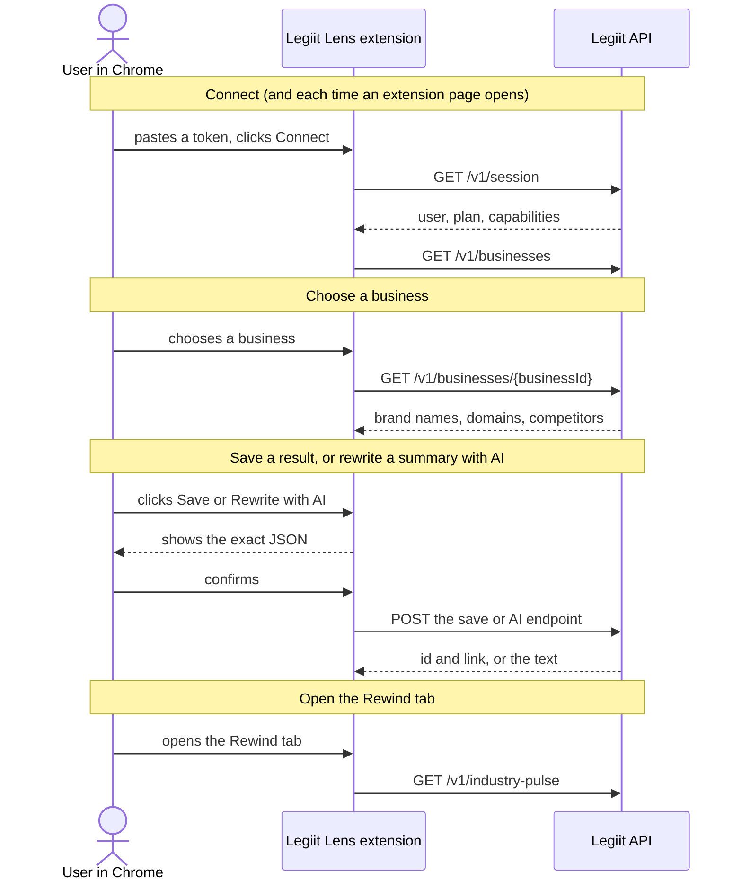

# Legiit Lens API: developer build guide

For the Legiit backend team. The Legiit Lens Chrome extension is finished and already calls this API. The API does not exist yet. This guide says what to build so that the extension works with it without another release.

| File | What it is |
| --- | --- |
| `README.md` | This guide: what to build, the rules for every endpoint, how to test |
| [`reference.md`](reference.md) | Every endpoint: fields, limits, meanings, examples. Generated from the contract |
| [`openapi.yaml`](openapi.yaml) | The contract (OpenAPI 3.1). Import it into Postman, Insomnia or Swagger UI |
| [`examples/`](examples) | Real request bodies built by the extension's code, and matching responses |
| [`../../mock-server/`](../../mock-server) | A working reference implementation in about 250 lines of Node (`npm run mock`) |
| [`../../tests/api/`](../../tests/api) | The check you run against your API (`npm run api:check`) |

If two of these ever disagree, `openapi.yaml` is right. Tell us, so we fix the other one.

## 1. What to build

Ten HTTPS endpoints, and two things in Command Center.

| # | Method and path | What it does | Capability |
| --- | --- | --- | --- |
| 1 | `GET /v1/session` | Checks the token. Returns the user, the plan and the enabled features | always on |
| 2 | `GET /v1/businesses` | Lists the user's businesses | `businesses` |
| 3 | `GET /v1/businesses/{businessId}` | Returns one business: brand names, domains, competitors | `businesses` |
| 4 | `POST /v1/businesses/{businessId}/visibility-snapshots` | Saves one measured Google results page | `visibilitySnapshots` |
| 5 | `POST /v1/businesses/{businessId}/gap-lists` | Saves a list of places where competitors appear and the business does not | `gapLists` |
| 6 | `POST /v1/businesses/{businessId}/competitors` | Adds a competitor to the business | `competitors` |
| 7 | `POST /v1/businesses/{businessId}/content-editor/documents` | Sends a content analysis of a page to the content editor | `contentEditor` |
| 8 | `POST /v1/workspaces/from-brief` | Creates a workspace from a client brief | `workspaces` |
| 9 | `GET /v1/industry-pulse` | Returns dated search-industry events | `industryPulse` |
| 10 | `POST /v1/ai/completions` | Rewrites a summary with Legiit's AI | `ai` |

Besides the API, Command Center needs:

1. **A page where a user creates and revokes an API token.** The user pastes the token into the extension. See [section 6](#6-what-command-center-needs-besides-the-api).
2. **A place where each saved item can be seen**, with an address. Each save returns that address, and the extension shows it as an "Open in Command Center" link.

You can ship endpoint by endpoint. The extension shows only the features whose capability you list ([section 4](#4-capabilities-launching-endpoint-by-endpoint)).

**Done** means two things: `npm run api:check` passes against your API ([section 8](#8-how-to-test)), and the short manual checklist in the same section passes with the real extension.

## 2. How the extension uses the API



- **Connecting is optional.** With no token stored, the extension never contacts the API.
- **Reads** happen when the user connects, opens an extension page (the side panel or the settings page), opens Settings, chooses a business, or opens the Rewind tab.
- **A POST is sent only after the user has seen the exact JSON body and confirmed it.** The extension never sends anything in the background. This is a promise in the extension's privacy policy.
- **Nothing is polled and nothing is retried automatically.** A connected user causes one `GET /v1/session` each time the side panel or the settings page opens, and about one request per click after that.
- **The extension only writes.** It never reads a saved item back, never edits one and never deletes one.
- Only `GET` and `POST` are used. There are no query strings.

## 3. Rules for every request

### Base URL

- Production is assumed to be `https://api.legiit.com`. Every path starts with `/v1`.
- A path prefix is fine, for example `https://legiit.com/api/lens` followed by `/v1/session`. Tell us the final base URL.
- **The host must be final before the extension is submitted to the Chrome Web Store.** It is written into the extension's manifest as a required host. Changing it later makes Chrome disable the extension for every user until they approve the new host.
- HTTPS only in production.
- **No redirects.** Answer on the URL that was called. The extension refuses a redirect to another host, and a redirected POST can lose its body.

### Authentication

- Every request carries `Authorization: Bearer <token>`. The token is the only credential.
- No cookies are sent. There is nothing to protect against CSRF: exempt these routes from CSRF checks.
- The token is opaque to the extension: any text of up to 4,096 characters without line breaks. The extension stores it as pasted (trimmed) and keeps using it until the API answers `401` to `GET /v1/session`.
- Answer `401` only when the token itself is bad, and answer it as JSON, not as a redirect to a login page. A `401` on `GET /v1/session` makes the extension delete the token.

### What arrives at the server

Captured from Chrome with a production build of the extension.

| Header | Value |
| --- | --- |
| `Authorization` | `Bearer <token>` |
| `Accept` | `application/json` |
| `Content-Type` | `application/json` (POST only) |
| `X-Legiit-Client` | `legiit-lens/<extension version>`, for example `legiit-lens/0.1.0` |
| `Idempotency-Key` | A random UUID. On the five saves only, not on reads and not on AI. See below |
| `Cache-Control`, `Pragma` | `no-cache`. The extension never uses a cached reply |
| `Origin` | `chrome-extension://<32 letters>` on POST. Not sent on GET |
| `User-Agent`, `Accept-Language`, `Accept-Encoding`, `Sec-Fetch-*` | Chrome's own values |
| `Cookie`, `Referer` | never sent |

- **No CORS setup is needed.** Chrome sends no preflight `OPTIONS` request, and the extension works against a server that returns no `Access-Control-*` headers at all. The reason: the API host is one of the extension's host permissions.
- Do not allow or block requests by `Origin` or `User-Agent`. The 32 letters are the extension's id, which is only known once the extension has been uploaded to the store.
- Do not put a browser challenge (CAPTCHA, JavaScript challenge, "checking your browser" page) in front of these routes. The extension cannot solve one.

### Request bodies

- JSON, UTF-8, always one object.
- **Never larger than 1 MB** (1,048,576 bytes). The extension refuses to send more. Typical sizes: a competitor 0.1 KB, an AI request 1 to 3 KB, a snapshot 2 to 5 KB, a content analysis 0.5 to 5 KB, a brief 10 to 40 KB, a gap list 2 to 60 KB.
- Every field in the contract is always present. A field with no value is sent as `null`, `""` or `[]`; these are valid. Do not reject them as "missing".
- Every text and every list has a maximum, stated in [`reference.md`](reference.md). The extension enforces them before sending, so you can size columns from them. Lengths are counted in UTF-16 code units; one unit is at most 3 bytes of UTF-8.
- All text is valid Unicode. It can contain any language, emoji and typographic quotes.
- **Ignore fields you do not know.** A later extension version may add fields. Do not validate with "no additional properties".
- Dates are ISO 8601 in UTC with milliseconds: `2026-11-20T12:00:00.000Z`. They come from the user's clock and say when something was measured, not when it was saved. Record your own time of receipt.
- Addresses of web pages are written the way browsers write them. They can contain characters that strict URI validators refuse (`|`, `[`, `]`). Check that they start with `http://` or `https://` and are at most 2,048 characters long, and nothing more.

### Replies

- JSON, with `Content-Type: application/json`, on the address that was called. Also for errors: no HTML error pages, and no redirect to a login page.
- **The body is the object shown in the reference, at the top level.** No wrapper such as `{"data": …}`, and no bare array.
- **Keys are camelCase and case-sensitive.** An optional key under another spelling (`brand_names`, `focus_keywords`) is treated as absent, without any error. Compare your replies with the files in [`examples/`](examples).
- **A successful save must return a JSON body with an `id`.** `201` and `200` are both accepted. A `204`, an empty body or an HTML page is treated as a failed save: the user is told so and will probably send it again.
- An `id` can be a string or an integer, whichever your database uses. Send an integer larger than 2^53 − 1 as a string. Ids are never cut.
- Text is a JSON string. Use `""` for empty text.
- An optional field can be left out or be `null`.
- You can add fields at any time. The extension ignores fields it does not know.
- Text longer than the stated maximum is cut, and a list longer than the maximum is cut. If an account can have more than 500 businesses, return the most relevant first.

The extension is forgiving beyond this, so that one odd row in your data does not break a user's screen: a list entry it cannot read (a business without an id, an event without a valid date) is skipped and the rest is used. Do not rely on it. `npm run api:check` checks the strict form.

### Time limits and retries

- The extension waits **20 seconds** for the complete reply, **60 seconds** for `POST /v1/ai/completions`. Then it tells the user that Legiit did not answer.
- Aim for under one second on reads and saves. The user is looking at a button that says "Sending…".
- The extension never retries on its own. The user can click again.

### Saving the same thing twice

A user can send the same save twice: after a timeout, or by saving the same result again later.

- Every save carries an `Idempotency-Key` header with a random UUID. Sending again from the same dialog repeats the key. **Recommended:** if you have already handled this key for this user in the last 24 hours, return the first response again and store nothing. Without this, a retry after a timeout creates a second item.
- Opening the dialog again creates a new key. So the same content can still arrive under two keys. Each save endpoint's page in [`reference.md`](reference.md) says which fields repeat in that case (`capturedAt`, `briefId`).
- `POST .../competitors` should never create a second competitor with the same name or domain. Answer `200` or `201` with the id of the existing one, not `409`.

## 4. Capabilities: launching endpoint by endpoint

`GET /v1/session` returns a list of capabilities. The extension shows a feature only when its capability is in the list, and it never calls an endpoint whose capability is missing.

| Capability | What the user gets | Endpoints behind it |
| --- | --- | --- |
| `businesses` | The business drop-down in Settings, and tracked brands pre-filled from the chosen business. Every save into a business needs one to be chosen | 2, 3 |
| `visibilitySnapshots` | "Save to Command Center" on the Click Potential tab | 4 |
| `gapLists` | "Save to Command Center" on the Why Not Me tab | 5 |
| `competitors` | "Add to Command Center" next to a competitor in Settings | 6 |
| `contentEditor` | "Send to content editor" on the New or Noise tab | 7 |
| `workspaces` | "Open in Command Center" on the Instant Brief tab | 8 |
| `industryPulse` | Date shortcuts on the Rewind tab | 9 |
| `ai` | "Rewrite with Legiit AI" on four tabs, and "Improve drafts with Legiit AI" on the Instant Brief tab | 10 |

- The smallest useful launch is `GET /v1/session` returning `"capabilities": []`. The user can connect and sees no Legiit feature. Add capabilities as endpoints go live.
- Use capabilities for plans too: leave out what the user's plan does not include.
- List `businesses` whenever you list one of the four capabilities below it in the table. Without it the user cannot choose a business, and those four saves stay disabled.
- Send the names exactly as written, in a JSON array. They are case-sensitive. The extension ignores a name it does not know, so a misspelt name hides its feature without any error. `npm run api:check` reports unknown names.
- Safety net: if an endpoint answers `404`, `405` or `501` although its capability is listed, the extension tells the user, then hides the feature until the side panel or settings page is opened again.

## 5. Errors

Every error reply has the same JSON body:

```json
{ "error": { "code": "not_found", "message": "No such business" } }
```

`message` is shown to the user after the status code, as plain text, up to 200 characters. Write one sentence the user can act on.

| Status | Use it when | What the extension does |
| --- | --- | --- |
| `401` | The token is missing, unknown, expired or revoked. Nothing else | On `GET /v1/session`: deletes the token and asks for a new one. Elsewhere: shows "Legiit did not accept the token" |
| `403` | The token is valid but this user may not do this | Shows "Legiit rejected the request (403)" and your message. Keeps the token |
| `404` with `error.code` `"not_found"` | The business in the path does not exist or is not this user's | Shows "Legiit could not find it (404)" and your message. The feature stays |
| any other `404`, `405`, `501` | The endpoint is not built or not enabled | Says that Legiit cannot receive this yet, then hides the feature |
| `422` or `400` | The body cannot be accepted | Keeps the dialog open, shows "Legiit rejected the request (422)" and your message |
| `429` | Too many requests | Shows your message. Does not read `Retry-After`, does not retry |
| `5xx` | Something failed on your side | Shows "Legiit had a problem" and the status. Does not retry |

The table describes the saves. For the other calls the extension falls back quietly when an endpoint is not there: no business list, no date shortcuts on the Rewind tab, and the built-in summary instead of the AI text, with a note that says why.

Three things to get right:

1. **The two kinds of 404.** A framework's own "route not found" page means "not built". "This business does not exist" must carry `"code": "not_found"` in the body above. Without that code, a deleted business makes the save button disappear with no explanation of why.
2. **Never `401` for anything but the token.** A plan limit is `403`, or better: leave the capability out of the session.
3. **A business that belongs to another user is `404` `not_found`**, the same as one that does not exist. Do not reveal that it exists.

## 6. What Command Center needs besides the API

### A page for API tokens

- The user creates a token, sees it once, copies it and pastes it into the extension's settings. The user can revoke it.
- A token acts as one user and can reach all of that user's businesses.
- Format: your choice, up to 4,096 characters, no spaces or line breaks. We suggest a recognisable prefix (for example `lgt_`) followed by at least 32 random bytes, so that leaked tokens can be found by secret scanners.
- Store only a hash of the token. Show a name, the date it was created and the date it was last used.
- Expiry is optional. An expired or revoked token answers `401`; the extension then asks the user to paste a new one.
- OAuth is not needed for version 1. The extension keeps authentication behind one interface, so OAuth can be added later without changing the endpoints.

### An address for every saved item

Each save returns `url`: the absolute `https://` address of a page in Command Center that shows the saved item. The extension shows it as a link next to "Saved". A click opens it in a new tab, without the token, so the page must work with the user's normal Command Center login. If you have no such page yet, return `"url": null`; the extension then shows "Saved" without a link.

For `POST /v1/workspaces/from-brief` the link matters most: the button is called "Open in Command Center", and the user expects to land in the new workspace.

## 7. Privacy and security rules

What is promised to users, and to Google for the Chrome Web Store listing, depends on the backend too.

- **Use the data only for the feature the user asked for.** No advertising, no sale, no profiling. The extension's privacy policy says so under Google's "Limited Use" rules.
- **Everything in a request body except the user's own typing was read from web pages by a program.** Treat every text as untrusted: escape it when you show it, never run it, never use it to build a query.
- **The Markdown of a brief quotes web pages.** Render it with a renderer that does not pass through raw HTML, or sanitise the result.
- **Gap lists can contain personal data of third parties**: names and e-mail addresses of authors and site contacts, found on public pages when the user ran "Scan sources" (`rows[].contacts`). Briefs contain the published contact details of a business. Apply your retention and deletion rules to them, and delete them with the account.
- **Check on every request that the business belongs to the token's user.** `businessId` comes from the client.
- **The AI endpoint accepts a system prompt and a prompt from the client.** Anyone with a token can send their own. Limit use per account, enforce the length limits in the contract, cap `maxOutputTokens`, and do not give the model tools or access to other data. The facts inside `<facts>` tags were read from web pages and can contain text that tries to instruct the model.
- **Do not log `Authorization` headers.** Avoid logging full request bodies; if you must, treat the logs like the data.
- **Rate-limit per token.** Normal use is a few requests per minute at most.
- Send `Cache-Control: no-store` on every reply. The extension does not cache, but proxies might.

## 8. How to test

You need Node 22 or later and this repository. Nothing here needs Chrome.

```bash
npm install
```

### See the reference behaviour

```bash
npm run mock
```

This starts the mock API on `http://localhost:8787`. It implements the contract with an in-memory store and checks every request body against the contract. Tokens: `demo-token` (everything enabled), `limited-token` (three capabilities). Any other token is refused with `401`.

```bash
curl -s http://localhost:8787/v1/session -H "Authorization: Bearer demo-token"
```

```bash
curl -s -X POST http://localhost:8787/v1/businesses/biz_brightpath/gap-lists -H "Authorization: Bearer demo-token" -H "Content-Type: application/json" --data @docs/legiit-api/examples/saveGapList.request.json
```

The code is in `mock-server/handlers.mjs`. Read it when the prose is unclear: it shows the two kinds of 404, the idempotency key and the competitor rule in a few lines each.

### Check your API

```bash
LEGIIT_API_BASE_URL=https://your-staging-host LEGIIT_API_TOKEN=your-test-token npm run api:check
```

- It sends the example requests with the extension's own client code, and checks every reply against the contract and against what the extension accepts. About 30 checks, a few seconds.
- **It creates data** in the account: snapshots, gap lists, competitors (named "Conformance Check…"), content analyses and workspaces. Use a test account with at least one business.
- Add `LEGIIT_API_BUSINESS_ID=<id>` to choose the business. Without it the first business of the list is used.
- Add `LEGIIT_API_WRITE=0` for a read-only run that creates nothing.
- Checks for a capability that the session does not list are skipped, so you can run it from the first endpoint on.
- At the end it prints a summary with warnings. A warning is a recommendation (for example a missing `url`); a failure means the extension would show an error to a user.

To see it pass, run it against the mock in a second terminal:

```bash
LEGIIT_API_BASE_URL=http://localhost:8787 LEGIIT_API_TOKEN=demo-token npm run api:check
```

### Check with the real extension

Do this once the check above passes.

```bash
LEGIIT_API_BASE_URL=https://your-staging-host npm run build
```

Then open `chrome://extensions`, switch on Developer mode, choose "Load unpacked" and select the `dist` folder.

1. Open the extension's settings, paste a token, click Connect. Your name and plan appear.
2. Choose a business. Its brand and competitors appear under "Tracked brands", marked as coming from Command Center.
3. Open a Google results page and click the extension's icon. On the Click Potential tab click "Save to Command Center", read the JSON, click "Send to Legiit". "Saved" appears with a link that opens the item.
4. Do the same on the Why Not Me tab.
5. Click "Rewrite with Legiit AI" on any tab. The summary is replaced by your model's text.
6. Revoke the token in Command Center and open the extension's settings again. It asks for a new token.

To see what the extension sent and received: right-click inside the side panel (or the settings page), choose Inspect, and open the Network tab. Do this before you click, so the request is recorded.

## 9. Decisions we need from Legiit

| # | Decision | Why it matters |
| --- | --- | --- |
| 1 | The final API host and base path | It is fixed in the extension's manifest before the store submission |
| 2 | Where the token page lives, the token format, and whether tokens expire | The extension's help text points users to it |
| 3 | What a "workspace" is in Command Center: a new business? Does the same `briefId` sent again update it or create another? | Decides what `POST /v1/workspaces/from-brief` stores and where its link leads |
| 4 | What the content editor creates from a content analysis | The body carries findings, not a text to edit |
| 5 | Which plan gets which capability | The session must list them per user |
| 6 | Which model answers `/v1/ai/completions`, and the usage limit per account | Cost and abuse control |
| 7 | Who keeps the Industry Pulse list up to date | It is an editorial list, the same for all users |
| 8 | How long saved items are kept, and how contact details in gap lists are handled | The privacy policy links to Legiit's policy for saved data |
| 9 | The address pattern for saved items in Command Center | Returned as `url` by every save |

## 10. Not in version 1

The extension does not use these, so do not build them for it: OAuth, reading saved items back, editing or deleting saved items, paging, webhooks, streaming AI replies, uploads of files or images, and translations of the error messages.

## 11. Changing the contract later

- The path prefix `/v1` is the version. Keep `/v1` working for as long as extension versions that call it are installed. Chrome updates extensions within days, but not instantly.
- **Safe at any time:** new optional fields in replies, new capability names, new endpoints, longer maximums in replies.
- **Needs a new extension release first:** new required fields in requests, new values of an enumeration in a request.
- **Never without a `/v2`:** removing or renaming a field or a path, changing a type, changing what a status code means.
- `X-Legiit-Client` tells you which extension version sent a request.
- Change `openapi.yaml` first. In this repository `npm run api:examples` then regenerates the examples and `reference.md`, and `npm test` fails until the extension, the mock server and the contract agree again.

## 12. Words used in this kit

| Word | Meaning |
| --- | --- |
| Business | A client or company in Command Center. Saves go into one business |
| Tracked brand | A name with domains that the extension looks for on a page. "Mine" is the user's own business; the others are competitors |
| Organic result | A normal Google result: not an ad, not a map listing, not an AI answer |
| First screen | What is visible on a results page before scrolling |
| Fold | The bottom edge of the first screen |
| Visibility snapshot | One measurement of one results page: where the organic results start, what fills the first screen, where the tracked brands rank |
| Surface | One block of a results page or AI answer where a brand can appear: the AI Overview, the organic list, the map pack, the citations of an AI answer |
| Gap | A place where a competitor appears and the user's own brand does not |
| Content analysis | A sentence-by-sentence comparison of one page with competing pages |
| Brief | A client brief the extension writes from a business's website |
| Avatar | A short description of a typical customer |
| Capability | A feature of the API that can be switched on per user |
