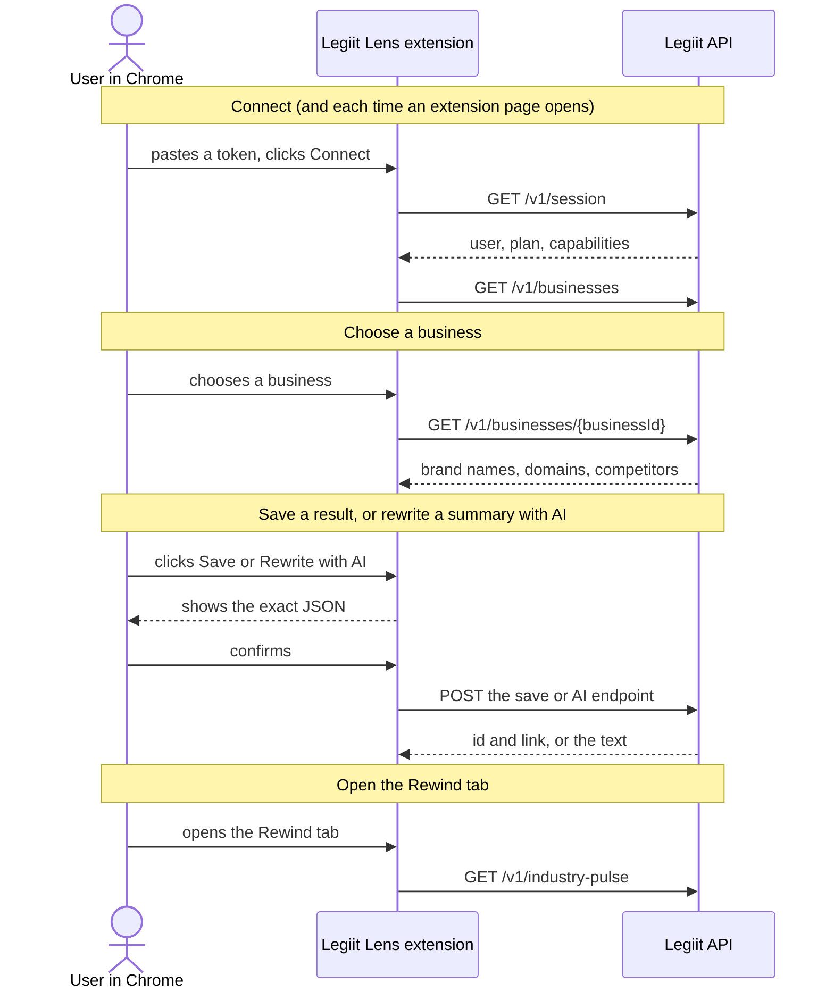

# Legiit Lens API: developer build guide

For the Legiit backend team. The Legiit Lens Chrome extension is finished and already calls this API. The API does not exist yet. This guide says what to build so that the extension works with it without another release.

Two independent developers built the whole API from this kit alone, one in Node and one in Python. Both passed the check in section 9 on the first run.

| File | What it is |
| --- | --- |
| `README.md` | This guide: what to build, the rules for every endpoint, how to test |
| [`reference.md`](reference.md) | Every endpoint: fields, limits, meanings, examples. Generated from the contract |
| [`openapi.yaml`](openapi.yaml) | The contract (OpenAPI 3.1) |
| [`openapi.examples.json`](openapi.examples.json) | The same contract with the examples built in. Import this one into Postman, Insomnia or Swagger UI |
| [`examples/`](examples) | Real request bodies built by the extension's code, and matching responses |
| [`../../mock-server/`](../../mock-server) | A working reference implementation in Node (`npm run mock`) |
| [`../../tests/api/`](../../tests/api) | The check you run against your API (`npm run api:check`) |

If two of these ever disagree, `openapi.yaml` is right. Tell us, so we fix the other one.

## 1. What to build

Ten HTTPS endpoints, and two things in Command Center.

| # | Method and path | What it does | Capability |
| --- | --- | --- | --- |
| 1 | `GET /v1/session` | Checks the token. Returns the user, the plan and the enabled features | always on |
| 2 | `GET /v1/businesses` | Lists the user's businesses | `businesses` |
| 3 | `GET /v1/businesses/{businessId}` | Returns one business: brand names, domains, competitors | `businesses` |
| 4 | `POST /v1/businesses/{businessId}/visibility-snapshots` | Saves one measured Google results page | `visibilitySnapshots` |
| 5 | `POST /v1/businesses/{businessId}/gap-lists` | Saves a list of places where competitors appear and the business does not | `gapLists` |
| 6 | `POST /v1/businesses/{businessId}/competitors` | Adds a competitor to the business | `competitors` |
| 7 | `POST /v1/businesses/{businessId}/content-editor/documents` | Sends a content analysis of a page to the content editor | `contentEditor` |
| 8 | `POST /v1/workspaces/from-brief` | Creates a workspace from a client brief | `workspaces` |
| 9 | `GET /v1/industry-pulse` | Returns dated search-industry events | `industryPulse` |
| 10 | `POST /v1/ai/completions` | Rewrites a summary with Legiit's AI | `ai` |

Besides the API, Command Center needs:

1. **A page where a user creates and revokes an API token.** The user pastes the token into the extension. See [section 6](#6-what-command-center-needs-besides-the-api).
2. **A page for each kind of saved item**, with an address. Each save returns that address, and the extension shows it as an "Open in Command Center" link.

You can ship endpoint by endpoint. The extension shows only the features whose capability you list ([section 4](#4-capabilities-launching-endpoint-by-endpoint)).

There are two levels of done:

- **API done:** `npm run api:check` passes against your API with all eight capabilities on, writes enabled and no check skipped ([section 9](#9-how-to-test)). `url` may still be `null`.
- **Launch done:** the token page and the pages for saved items exist, every save returns a `url`, and the manual checklist in section 9 passes with the real extension.

## 2. How the extension uses the API



- **Connecting is optional.** With no token stored, the extension never contacts the API.
- **A POST is sent only after the user has seen the exact JSON body and confirmed it.** The extension never sends anything in the background. This is a promise in the extension's privacy policy.
- **Nothing is polled and nothing is retried automatically.**
- **The extension only writes.** It never reads a saved item back, never edits one and never deletes one.
- Only `GET` and `POST` are used. There are no query strings.

What causes a request:

| The user… | Requests |
| --- | --- |
| clicks Connect, or "Try again" | `GET /v1/session` |
| opens the side panel or the settings page while a token is stored | `GET /v1/session` |
| has other extension pages open when the token changes | `GET /v1/session` from each of them |
| sees the settings screen while connected | `GET /v1/businesses` |
| chooses a business | `GET /v1/businesses/{businessId}` |
| opens the Rewind tab while connected | `GET /v1/industry-pulse` |
| confirms a save or an AI rewrite | one `POST` |

So a normal user causes a few requests per minute at most. Judge volume on the built extension (`npm run build`), not on `npm run dev`, where React sends each read twice.

## 3. Rules for every request

### Base URL

- Production is assumed to be `https://api.legiit.com`. Every path starts with `/v1`.
- A path prefix is fine, for example `https://legiit.com/api/lens` followed by `/v1/session`. Tell us the final base URL.
- **The host must be final before the extension is submitted to the Chrome Web Store.** It is written into the extension's manifest as a required host. Changing it later makes Chrome disable the extension for every user until they approve the new host.
- HTTPS only in production.
- **No redirects.** Answer on the URL that was called. The extension never follows a redirect: it reports "Could not reach Legiit". The usual causes are a framework that adds or removes a trailing slash, a redirect to a canonical host, and a redirect to a login page.

### Authentication

- Every request carries `Authorization: Bearer <token>`. The token is the only credential. Match the word `Bearer` without regard to case.
- No cookies are sent. There is nothing to protect against CSRF: exempt these routes from CSRF checks.
- A token is printable ASCII without spaces, at most 4,096 characters. The extension refuses to store anything else.
- **Answer `401` only when the token itself is bad, as JSON with the error body.** A `401` on `GET /v1/session` makes the extension delete the token. Nothing in front of the API (a gateway, a proxy, HTTP Basic auth on a staging site) may answer `401` for a valid token. During an outage of your own login system, answer `503`.
- For a valid token `GET /v1/session` always answers `200`. Say what the user may use through `capabilities`, not through `403` on the session.

### What arrives at the server

Captured from Chrome with a production build of the extension.

| Header | Value |
| --- | --- |
| `Authorization` | `Bearer <token>` |
| `Accept` | `application/json` |
| `Content-Type` | `application/json` (POST only) |
| `X-Legiit-Client` | `legiit-lens/<extension version>`, for example `legiit-lens/0.1.0`. For your logs: do not require it |
| `Idempotency-Key` | A random UUID. On the five saves only, not on reads and not on AI. Do not require it. See below |
| `Cache-Control`, `Pragma` | `no-cache`. The extension never uses a cached reply |
| `Origin` | `chrome-extension://<32 letters>` on POST. Not sent on GET |
| `User-Agent`, `Accept-Language`, `Accept-Encoding`, `Sec-Fetch-*` | Chrome's own values |
| `Cookie`, `Referer` | never sent |

- Do not allow or block requests by `Origin` or `User-Agent`. The 32 letters are the extension's id, which is only known once the extension has been uploaded to the store.
- Do not put a browser challenge (CAPTCHA, JavaScript challenge, "checking your browser" page) in front of these routes. The extension cannot solve one.
- Exempt these routes from firewall rules that inspect request bodies. The bodies carry text read from web pages, which can look like HTML or SQL.

### CORS: not needed, but send it anyway

In the normal case Chrome sends no preflight `OPTIONS` request, and the extension works against a server that returns no `Access-Control-*` headers at all. The reason: the API host is one of the extension's host permissions.

A user can switch that permission off in Chrome ("Site access" in the extension's details). Chrome then treats the extension's requests like a web page's and preflights every one. We tested both cases: without CORS headers the extension cannot connect; with them everything works. So send them as a safety net:

```
Access-Control-Allow-Origin: *
Access-Control-Allow-Methods: GET, POST, OPTIONS
Access-Control-Allow-Headers: authorization, content-type, accept, x-legiit-client, idempotency-key
Access-Control-Max-Age: 600
```

Answer `OPTIONS` on every path with `204` and these headers, without asking for a token. Allowing every origin is safe here, because no cookies are used: without a token a request gets nothing.

### Request bodies

- JSON, UTF-8, always one object.
- **Accept bodies of up to 1 MB** (1,048,576 bytes) on every POST. The extension never sends more. Raise the limit of your framework or proxy if it is lower (Express accepts 100 KB by default). You may answer `413` to anything larger.
- The examples in this kit are 0.1 KB (a competitor), 1 to 3 KB (an AI request), 0.5 to 2.5 KB (a snapshot), 0.5 to 2 KB (a content analysis), 4 to 9 KB (a brief) and 0.5 to 11 KB (a gap list). Real bodies can be several times larger. The largest possible body is a brief of about 600 KB.
- Every required field is in every request. A field with no value is sent as `null`, `""` or `[]`, as its row in the reference says. **These are valid values: do not reject them as "missing".** One field can be absent: `responseSchema` of the AI request.
- Every text and every list has a maximum, stated in [`reference.md`](reference.md). The extension enforces them before sending, so you can size columns from them. Every integer fits a signed 32-bit column.
- Lengths are counted in UTF-16 code units. If you check lengths, count characters (PHP `mb_strlen`, Laravel `max:`, Python `len`): a text within its limit in UTF-16 units is always within it in characters. Never count bytes (PHP `strlen`).
- All text is valid Unicode. It can contain any language, emoji and typographic quotes.
- **Ignore fields you do not know.** A later extension version may add fields. Do not validate with "no additional properties".
- **Accept values you do not know** where the reference says "Values in this version": store the value as text. A later extension version may add values. Where the reference says "One of", the list is closed.
- Dates are ISO 8601 in UTC with milliseconds: `2026-11-20T12:00:00.000Z`. They come from the user's clock and say when something was measured, not when it was saved. Accept dates in the past and slightly in the future, and record your own time of receipt.
- Addresses of web pages are written the way browsers write them. They can contain characters that strict URI validators refuse (`|`, `[`, `]`). Check that they start with `http://` or `https://` and are at most 2,048 characters long, and nothing more. One field, `rows[].contacts[].url` of a gap list, can also start with `mailto:`.
- **Never fetch an address from a request body** without blocking private and internal addresses. The addresses come from web pages.

What to validate:

| | |
| --- | --- |
| Must | The body is one JSON object with the required keys in the right types. Otherwise answer `422` (or `400` for a body that is not JSON) with the error body. The check sends `{}` and a body that is cut off |
| Should | The maximum lengths, list sizes and closed lists of the contract |
| Not needed | Rules that the reference writes as a sentence, such as "null exactly when…" or "always the number of…". They describe what the extension sends. Do not reject a request because of them |

### Replies

- JSON, with `Content-Type: application/json` (a `charset` is fine), on the address that was called. Also for errors: no HTML error pages, and no redirect to a login page.
- **The body is the object shown in the reference, at the top level.** No wrapper such as `{"data": …}`, and no bare array.
- **Keys are camelCase and case-sensitive.** An optional key under another spelling (`brand_names`, `focus_keywords`) is treated as absent, without any error in the extension. `npm run api:check` reports such keys.
- **Every list is a JSON array**, also when it is empty or filtered. In PHP, re-index a filtered array with `array_values` before encoding it.
- **A successful save must return a JSON body with an `id` at the top level.** `201` and `200` are both accepted. A `204`, an empty body or an HTML page is treated as a failed save: the user is told so and will probably send it again.
- An `id` can be a string or an integer, whichever your database uses. Send an integer larger than 2^53 − 1 as a string. Return the same id for the same thing everywhere.
- Text is a JSON string. Use `""` for empty text.
- An optional field can be left out or be `null`.
- You can add fields at any time. The extension ignores fields it does not know.
- Where the reference says "first N chars are used" or "first N items are used", you do not have to cut anything: the extension cuts what is longer. With more than 500 businesses, return the most recently used first.
- Send `Cache-Control: no-store` on every reply.

The extension is forgiving beyond this, so that one odd row in your data does not break a user's screen: a list entry it cannot read (a business without an id, an event without a valid date) is skipped and the rest is used. Do not rely on it. `npm run api:check` checks the strict form.

### Time limits and retries

- The extension waits **20 seconds** for the complete reply, **60 seconds** for `POST /v1/ai/completions`. Then it tells the user that Legiit did not answer. Your server is not told, and may still finish the work.
- Aim for under one second on reads and saves. The user is looking at a button that says "Sending…".
- The extension never retries on its own. The user can click again.

### Saving the same thing twice

A user can send the same save twice: from the same dialog after a timeout or an error, or by opening the dialog again later.

| Save | The same `Idempotency-Key` again | The same content under a new key |
| --- | --- | --- |
| Visibility snapshot | Return the first reply; store nothing | Store a new snapshot |
| Gap list | Return the first reply; store nothing | Store a new list |
| Content analysis | Return the first reply; store nothing | Store a new item |
| Competitor | Return the first reply; store nothing | Return the existing competitor's id with `200` |
| Workspace from a brief | Return the first reply; store nothing | The same `briefId` of the same user: update that workspace and return its id with `200` |

The left column is the `Idempotency-Key` rule. It is recommended, and the check warns when it is missing:

- Remember the reply of a **successful** save under (user, method, path, key) for 24 hours. Answer the same key with that reply again: same status, same body.
- **Never remember an error.** After a `422`, `429` or `5xx` the dialog stays open, and the next click sends the same key with the same body. That attempt must be handled afresh.
- Do not compare bodies. If the first request with a key is still running, wait for it or answer `409`.
- Do not require the header and do not check its format. The extension always sends it; `curl` and the check also send saves without it.

The right column needs no key. Never de-duplicate snapshots, gap lists or content analyses by their content: the same reading saved twice is two items, and both carry the same `capturedAt`.

## 4. Capabilities: launching endpoint by endpoint

`GET /v1/session` returns a list of capabilities. The extension shows a feature only when its capability is in the list, and it never calls an endpoint whose capability is missing.

| Capability | What the user gets | Endpoints behind it |
| --- | --- | --- |
| `businesses` | The business drop-down in Settings, and tracked brands pre-filled from the chosen business. Every save into a business needs one to be chosen | 2, 3 |
| `visibilitySnapshots` | "Save to Command Center" on the Click Potential tab | 4 |
| `gapLists` | "Save to Command Center" on the Why Not Me tab | 5 |
| `competitors` | "Add to Command Center" next to a competitor in Settings | 6 |
| `contentEditor` | "Send to content editor" on the New or Noise tab | 7 |
| `workspaces` | "Open in Command Center" on the Instant Brief tab | 8 |
| `industryPulse` | Date shortcuts on the Rewind tab | 9 |
| `ai` | "Rewrite with Legiit AI" on four tabs, and "Improve drafts with Legiit AI" on the Instant Brief tab | 10 |

- The smallest useful launch is `GET /v1/session` returning `"capabilities": []`. The user can connect and sees no Legiit feature. Add capabilities as endpoints go live.
- Capabilities belong to the user: every token of a user gets the same list. Use them for plans too: leave out what the user's plan does not include.
- List `businesses` whenever you list one of the four capabilities below it in the table. Without it the user cannot choose a business, and those four saves stay disabled.
- Send the names exactly as written, in a JSON array. They are case-sensitive. The extension ignores a name it does not know, so a misspelt name hides its feature without any error. `npm run api:check` warns about unknown names.
- An endpoint whose capability is not in the user's session answers `404`, like an endpoint that does not exist.
- The extension reads the capabilities when the side panel or the settings page opens. A page that stays open keeps the list it read: after a plan change the user sees the new features when they open the panel again.
- Safety net: if a save answers `404`, `405` or `501` although its capability is listed, the extension tells the user, then hides that button in that page until the page is opened again or the user reconnects.

## 5. Errors

Every error reply has the same JSON body, including the errors your framework produces by itself (validation, throttling, authorisation, a missing record, a body that is too large):

```json
{ "error": { "code": "not_found", "message": "No such business" } }
```

`message` is one sentence the user can act on. It is shown after the status code, as plain text, up to 200 characters, for every `4xx` except `401` and except a `404` that means "not built".

| Status | Use it when | What the extension does |
| --- | --- | --- |
| `401` | The token is missing, unknown, expired or revoked. Nothing else | On `GET /v1/session`: deletes the token and asks for a new one. Elsewhere: shows "Legiit did not accept the token" |
| `403` | The token is valid and the user has the feature, but this one request is refused (a role, a quota) | Shows "Legiit rejected the request (403)" and your message. Keeps the token |
| `404` with `error.code` `"not_found"` | The business in the path does not exist or is not this user's | Shows "Legiit could not find it (404)" and your message. The feature stays |
| any other `404`, `405`, `501` | The endpoint is not built, or its capability is not enabled for this user | Says that Legiit cannot receive this yet, then hides that button |
| `422`, `400`, `413`, any other `4xx` | The body cannot be accepted | Keeps the dialog open, shows "Legiit rejected the request (422)" and your message |
| `429` | Too many requests | Shows your message. Does not read `Retry-After`, does not retry. Say in the message when to try again |
| `5xx` except `501` | Something failed on your side | Shows "Legiit had a problem" and the status. Does not retry |

The third column describes a save. The other calls fall back quietly:

| Call | When it fails |
| --- | --- |
| `GET /v1/session` at Connect | The reason is shown, and nothing is stored: the user clicks Connect again |
| `GET /v1/session` when a page opens | Only a `401` with the error body deletes the token. For anything else the token is kept, the panel shows "Legiit not connected" with the reason, and Settings offers "Try again". No other call is made meanwhile |
| `GET /v1/businesses` | Not built: the drop-down is hidden. Any other failure: the reason is shown under it |
| `GET /v1/businesses/{businessId}` | The reason is shown; what was pre-filled before stays |
| `GET /v1/industry-pulse` | No date shortcuts, no message |
| `POST /v1/ai/completions` | The built-in text stays, with one line that says why. After a `404`, `405` or `501` the button goes away |

Four things to get right:

1. **The two kinds of 404.** "This business does not exist" must carry `"code": "not_found"`, on every path with a business id. Without that code, a deleted business makes the save button disappear with no explanation. An id that cannot exist in your scheme (text where you use numbers) should get the same answer, and must never cause a `500`.
2. **`not_found` is reserved for a missing business.** An unknown path, a wrong method or a switched-off capability must use another code, or no body at all. Check what your framework puts in its own 404.
3. **Never `401` for anything but the token.**
4. **A business that belongs to another user is `404` `not_found`**, the same as one that does not exist. Do not reveal that it exists.

When several errors apply at once, any order passes the check. The mock answers in this order: token (`401`), body size (`413`), JSON syntax (`400`), endpoint and capability (`404`), business (`404` `not_found`), fields (`422`).

## 6. What Command Center needs besides the API

### A page for API tokens

- The user creates a token, sees it once, copies it and pastes it into the extension's settings. The user can see their tokens (name, created, last used) and revoke each one.
- A token acts as one user. It reaches every business that user may save into: their own, and those shared with them.
- Format: printable ASCII without spaces, well under 4,096 characters. We suggest a recognisable prefix (for example `lgt_`) followed by at least 32 random bytes in base64url, so that leaked tokens can be found by secret scanners.
- Store only a hash of the token. Use a plain SHA-256 of the token, so that the row can be found by its hash; a password hash such as bcrypt cannot be looked up.
- Make tokens long-lived and revocable. The extension has no refresh: an expired or revoked token answers `401`, and the user must paste a new one.
- There is no logout call. Disconnecting in the extension only deletes the token on the device.
- Tell us the address of this page, so that a later extension release can link to it.
- OAuth is not needed for version 1. The extension keeps authentication behind one interface, so OAuth can be added later without changing the endpoints.

### A page for every kind of saved item

Each save returns `url`: the absolute address of a page in Command Center that shows the saved item. The extension shows it as a link next to "Saved". A click opens it in a new tab, without the token, so the page must work with the user's normal Command Center login. Until a page exists, return `"url": null`; the extension then shows "Saved" without a link, and the check warns.

What each page has to show, as a minimum:

| Saved item | Minimum content of its page |
| --- | --- |
| Visibility snapshot | Keyword, date, Google site and window size; the grade, marked as an estimate; what fills the first screen; the organic results with their positions; where the tracked brands rank |
| Gap list | Source, question and date; one line per row: where the gap is, the page, the competitors named, the reason, and the contact links |
| Competitor | The business's list of competitors, with the new one in it |
| Content analysis | Keyword, page and date; "Only on this page" (the sentences nobody else makes); "Missing points" with their source links |
| Workspace | The brief: render its `markdown` |

For a workspace the link matters most: the button that starts the save is called "Open in Command Center", so the user expects to land in the new workspace.

## 7. Privacy and security rules

What is promised to users, and to Google for the Chrome Web Store listing, depends on the backend too.

- **Use the data only for the feature the user asked for.** No advertising, no sale, no profiling. The extension's privacy policy says so under Google's "Limited Use" rules.
- **People at Legiit do not read saved items**, except with the user's consent, for security, or where the law requires it. Keep request bodies out of support tools, error trackers and analytics.
- **If the AI model is run by another company**, that company processes the prompt for Legiit: it must not train on it or keep it. The extension's privacy policy must name it before launch (decision 6).
- **Everything in a request body except the user's own typing was read from web pages by a program.** Treat every text as untrusted: escape it when you show it, never run it, never use it to build a query.
- **The Markdown of a brief quotes web pages.** Render it with raw HTML and unsafe links switched off: `[x](javascript:…)` is a link, not raw HTML.
- **Gap lists can contain personal data of third parties**: names and e-mail addresses of authors and site contacts, found on public pages when the user ran "Scan sources" (`rows[].contacts`). Briefs contain the published contact details of a business. Store contacts so that one e-mail address can be found and deleted. Apply your retention rules, and delete everything with the account.
- **Check on every request that the business belongs to the token's user.** `businessId` comes from the client, and it can be stale: the extension keeps the chosen business until the user chooses another, also across a token change.
- **Look up `briefId` and `Idempotency-Key` per user**, never across users. Both are made on the user's device.
- **The AI endpoint accepts a system prompt and a prompt from the client.** Anyone with a token can send their own. Limit use per user, enforce the length limits in the contract, cap the output tokens, and give the model no tools and no access to other data. The facts between `<facts>` tags were read from web pages and can contain text that tries to instruct the model.
- **Do not log `Authorization` headers.** Avoid logging full request bodies; if you must, treat the logs like the data.
- **Rate-limit per user, and keep `GET /v1/session` out of tight limits.** A starting point: 120 reads and 60 saves per minute, and an AI allowance per day. The check in section 9 sends about 45 requests in under a second, 3 of them AI calls: exempt the test account, or allow for it.

## 8. Notes for Laravel, Express and Django

Defaults of common frameworks that break this API. The check in section 9 catches most of them.

| Trap | What to do |
| --- | --- |
| The framework answers a missing record or an unknown route in its own shape | Convert every error for `/v1/*` to the error body of section 5: one `renderable` in Laravel's exception handler, a final error middleware in Express, a custom exception handler in Django REST Framework |
| Laravel's `required` rule refuses `""` and `[]`, and `ConvertEmptyStringsToNull` turns `""` into `null` | Use `present` (with `nullable` where the reference allows `null`), and exclude these routes from that middleware |
| An integer route parameter (`whereNumber`, `<int:id>`) makes the framework answer its own 404 for an id of another form | Best: catch it and answer `404` with the code `not_found`. The check reports anything else as a warning, and a `5xx` as a failure |
| CSRF middleware, a CORS allow-list by origin | Exempt these routes from CSRF; allow every origin (section 3) |
| `express.json()` accepts 100 KB; nginx 1 MB; PHP 8 MB | Accept 1 MB on every POST |
| A MySQL `TEXT` column holds 64 KB | `markdown` of a brief can be 600 KB: use `MEDIUMTEXT`, or a JSON column for the whole body |
| PHP encodes a filtered array as an object | `array_values()` before `json_encode` |
| `JSON_NUMERIC_CHECK` turns the text `"365"` into a number | Do not use it. Names and keywords are text |
| Laravel's `Str::markdown()` passes raw HTML and unsafe links through | `Str::markdown($md, ['html_input' => 'escape', 'allow_unsafe_links' => false])` |
| A staging site behind HTTP Basic auth | It cannot work: the `Authorization` header carries the token, and its `401` makes the extension delete the token |
| A redirect that adds a trailing slash, or sends an unauthenticated call to a login page | Switch it off for these routes: answer `401` as JSON |

## 9. How to test

You need Node 22 or later and this repository. The first two parts need no Chrome.

```bash
npm install
```

This installs the extension's whole toolchain: about 1 GB and a few minutes.

### See the reference behaviour

```bash
npm run mock
```

This starts the mock API on `http://localhost:8787` (`PORT=8788 npm run mock` for another port). It implements the contract with an in-memory store and checks every request body against the contract. Tokens: `demo-token` (everything enabled), `limited-token` (three capabilities). Any other token is refused with `401`.

```bash
curl -s http://localhost:8787/v1/session -H "Authorization: Bearer demo-token"
```

```bash
curl -s -X POST http://localhost:8787/v1/businesses/biz_brightpath/gap-lists -H "Authorization: Bearer demo-token" -H "Content-Type: application/json" --data @docs/legiit-api/examples/saveGapList.request.json
```

The code is in `mock-server/handlers.mjs`, about 280 lines. Its header lists where each rule of this guide is implemented. Read it when the prose is unclear. Its health page (`/health`) and its tolerance for a trailing slash are conveniences, not part of the contract.

### Check your API

```bash
npm run api:check -- https://your-staging-host your-test-token
```

The same command works in bash, PowerShell and cmd.

- It sends the example requests with the extension's own client code, and checks every reply against the contract and against what the extension accepts. 30 checks, a few seconds, about 45 requests.
- **It creates data** in the account: snapshots, gap lists, content analyses, competitors and workspaces. Competitors and workspaces are named "Conformance Check: …"; the snapshots and gap lists are for the keyword "best dentist in austin". Use a test account with at least one business.
- Add `--business=<id>` to choose the business. Without it the first business of the list is used.
- Add `--read-only` for a run that creates nothing. It still calls the AI endpoint three times.
- Add `--other-business=<id>`, with the id of a business of **another** user, to check that this token cannot reach it.
- Checks for a capability that the session does not list are skipped, so you can run it from the first endpoint on. A run with skipped checks proves only the rest.
- It ends with a summary. A failure means the reply breaks the contract; most failures would show an error to a user. A warning is a recommendation, for example a missing `url`.

To see it pass, run it against the mock in a second terminal:

```bash
npm run api:check -- http://localhost:8787 demo-token
```

The check does not cover everything. Test these yourself: rate limiting; a body larger than 1 MB; the same `Idempotency-Key` after an error; what the AI endpoint does when the model is slow or returns broken JSON; and everything in section 7.

### Check with the real extension

Do this once the check above passes.

```bash
LEGIIT_API_BASE_URL=https://your-staging-host npm run build
```

In PowerShell, set the variable first: `$env:LEGIIT_API_BASE_URL='https://your-staging-host'; npm run build`.

Then open `chrome://extensions`, switch on Developer mode, choose "Load unpacked" and select the `dist` folder.

1. Open the extension's settings, paste a token, click Connect. Your name and plan appear.
2. Choose a business. Its brand appears under "My brands" and its competitors under "Competitors", marked "From Command Center".
3. Open a Google results page and click the extension's icon. On the Click Potential tab click "Save to Command Center", read the JSON, click "Send to Legiit". "Saved" appears with a link that opens the item.
4. Do the same on the Why Not Me tab.
5. Click "Rewrite with Legiit AI" on the Click Potential tab, read the JSON, click "Send". The summary is replaced by your model's text.
6. Revoke the token in Command Center and open the extension's settings again. It says that the token was not accepted and asks for a new one.
7. With a token of user A, save into a business of user B (change the business id in a `curl` call). The answer is `404` `not_found`.

To see what the extension sent and received: right-click inside the side panel (or the settings page), choose Inspect, and open the Network tab. Do this before you click, so the request is recorded.

## 10. Questions developers ask

Every question here was asked, or guessed at, by a developer who built the API from this kit.

| Question | Answer |
| --- | --- |
| A trailing slash, a query string? | The extension sends neither. Do what your framework does, without redirecting |
| What do I answer for an unknown path, or a known path with another method? | `404` or `405`, with any body or none. If you send the error body, use any code except `not_found` |
| Must I refuse a request without `Content-Type: application/json`? | No. The extension always sends it |
| `WWW-Authenticate` on a `401`? | Optional. The extension ignores it |
| May replies be compressed? | Yes. Chrome sends `Accept-Encoding` |
| What is in the body of a `5xx`? | Anything. It is not shown |
| `400` or `422`? | `400` for a body that is not JSON, `422` for JSON that breaks the contract. The extension treats them alike |
| A date without milliseconds, or with an offset? | The extension always sends UTC with milliseconds and `Z`. Accept any ISO 8601 date and time |
| Is `10.0` an integer? | The extension sends integers without a fraction |
| Does a save into a business also need the `businesses` capability on the server? | No. Each endpoint checks its own capability |
| When would I use `403`? | For one request of a feature the user has: a read-only role, a quota that is used up. For a feature the user does not have, leave the capability out |
| A business has 200 competitors and the user adds another? | Your decision. If you refuse, answer `422` with a message |
| Must a competitor that was added appear in Business Details at once? | Yes, anywhere in the list |
| Does a workspace have to appear in `GET /v1/businesses`? | Not for the extension. It is decision 3 |
| Which keys of `responseSchema` must I support? | `type`, `properties`, `required`, `items`, `minItems`, `maxItems`, `additionalProperties`. Pass the schema to the model's structured-output option, or put it into the prompt |
| A `responseSchema` with a task other than "brief"? | The schema decides: return JSON whenever it is present |
| `maxOutputTokens` is above my maximum? | Use your maximum. Do not refuse the request |
| What does `model` in the AI reply have to be? | Any text, or leave it out |
| Should I validate the model's JSON before returning it? | Check that it parses. If it does not, ask the model once more, then answer `502` |
| How exact must my length checks be? | Count characters, not bytes (section 3). Exact in Python: `len(s.encode('utf-16-le')) // 2` |
| Is there an API to create tokens? | No. Tokens are created on a page in Command Center |
| How does the extension notice that a token was revoked? | The next save shows "Legiit did not accept the token". The token is deleted the next time the panel or the settings page opens |
| Can one extension talk to staging and production? | No. The host is built in. A staging test needs its own build (section 9) |

## 11. Decisions we need from Legiit

Each row has a recommendation. If nobody decides, the recommendation is what gets built.

| # | Decision | Our recommendation | Who | Blocks |
| --- | --- | --- | --- | --- |
| 1 | Where does the API live? | `https://api.legiit.com`, a host of its own. It cannot change after the extension is in the store | Engineering | The store submission |
| 2 | Where do users create a token, and how long does it last? | A "Legiit Lens" page in Command Center's settings. Tokens do not expire; the user can revoke them | Product | Connecting |
| 3 | What is a "workspace" made from a brief? | A new client in Command Center that shows the brief. Sending the same brief again updates it. If a workspace is a business, list it among the user's businesses | Product | Endpoint 8 |
| 4 | What does the content editor make of a content analysis? | A note on the business with two lists: "Only on this page" and "Missing points" | Product | Endpoint 7 |
| 5 | Which plan gets which feature? | Every paid plan gets all eight; decide what a free plan gets | Product | The session |
| 6 | Which AI model answers, and how much may one user use? | A model that Legiit already pays for, with a daily allowance per user. If another company runs it, the privacy policy must name it | Product, legal | Endpoint 10 |
| 7 | Who keeps the Industry Pulse list up to date? | One named person adds each Google update with its date | Product | Endpoint 9 |
| 8 | How long are saved items kept? | As long as the account exists; deleted with it. Contact details in gap lists follow Legiit's privacy policy | Legal | The privacy policy link |
| 9 | What are the addresses of saved items in Command Center? | One page per kind of item (section 6) | Engineering | The "Open in Command Center" links |
| 10 | Which businesses does a team member's token see? | Every business that person may save into, their own and shared ones | Product | Endpoints 2 to 7 |
| 11 | Is there a test account for Google's reviewers? | Yes: one account with one business and a token, before the store submission that switches the API on | Product | The store review |
| 12 | Is there a staging server for testing? | Yes, on its own host, without HTTP Basic auth in front | Engineering | Testing |

## 12. Not in version 1

The extension does not use these, so do not build them for it: OAuth, a logout call, reading saved items back, editing or deleting saved items, paging, webhooks, streaming AI replies, uploads of files or images, and translations of the error messages.

## 13. Changing the contract later

- The path prefix `/v1` is the version. Keep `/v1` working for as long as extension versions that call it are installed. Chrome updates extensions within days, but not instantly.
- **Safe at any time:** new optional fields in replies, new capability names, new endpoints, longer text in replies (not longer ids).
- **Safe when you store values as text:** a new value where the reference says "Values in this version". A later extension version may send one.
- **Needs a new extension release first:** new required fields in requests.
- **Never without a `/v2`:** removing or renaming a field or a path, changing a type, changing what a status code means.
- `X-Legiit-Client` tells you which extension version sent a request.
- Change `openapi.yaml` first. In this repository `npm run api:examples` then regenerates the examples, `reference.md` and `openapi.examples.json`, and `npm test` fails until the extension, the mock server and the contract agree again.

## 14. Words used in this kit

| Word | Meaning |
| --- | --- |
| Business | A client or company in Command Center. Saves go into one business |
| Tracked brand | A name with domains that the extension looks for on a page. "Mine" is the user's own business; the others are competitors |
| Organic result | A normal Google result: not an ad, not a map listing, not an AI answer |
| First screen | What is visible on a results page before scrolling |
| Fold | The bottom edge of the first screen |
| Visibility snapshot | One measurement of one results page: where the organic results start, what fills the first screen, where the tracked brands rank |
| Surface | One block of a results page or AI answer where a brand can appear: the AI Overview, the organic list, the map pack, the citations of an AI answer |
| Gap | A place where a competitor appears and the user's own brand does not |
| Content analysis | A sentence-by-sentence comparison of one text with competing pages |
| Brief | A client brief the extension writes from a business's website |
| Avatar | A short description of a typical customer |
| Capability | A feature of the API that can be switched on per user |
