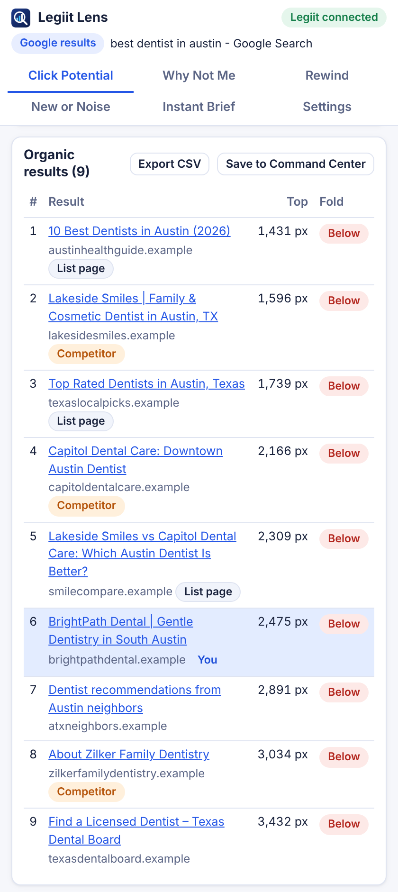
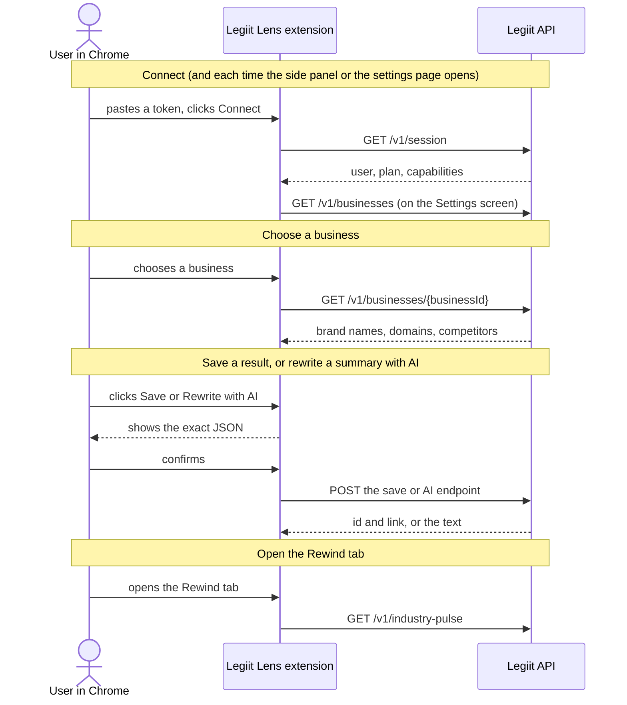
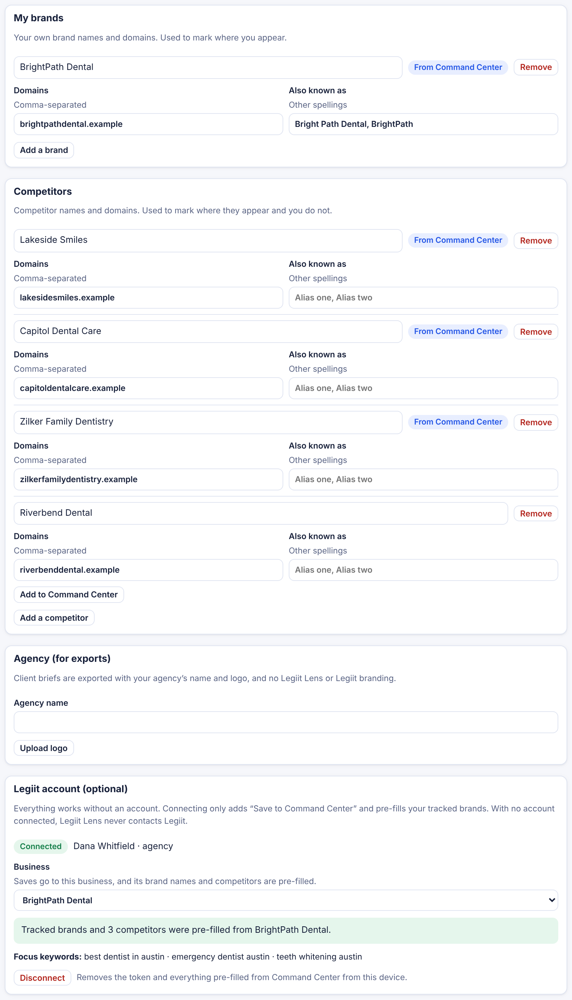
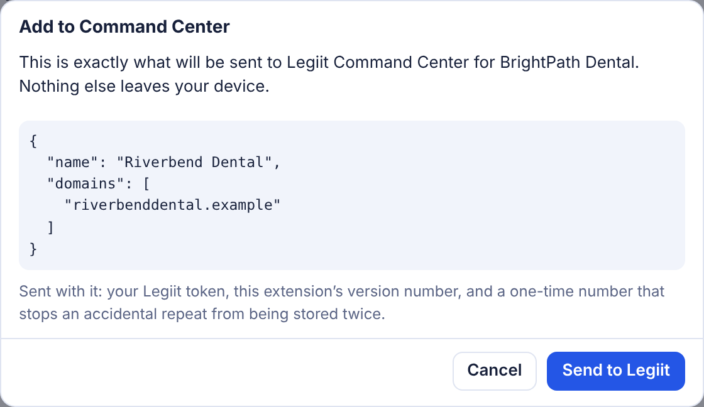
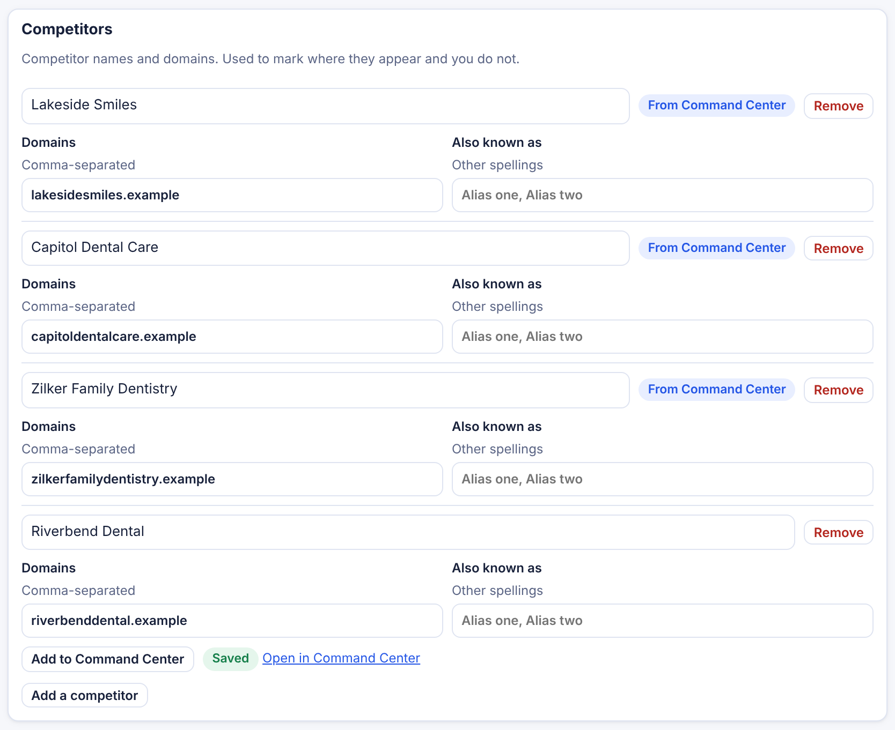
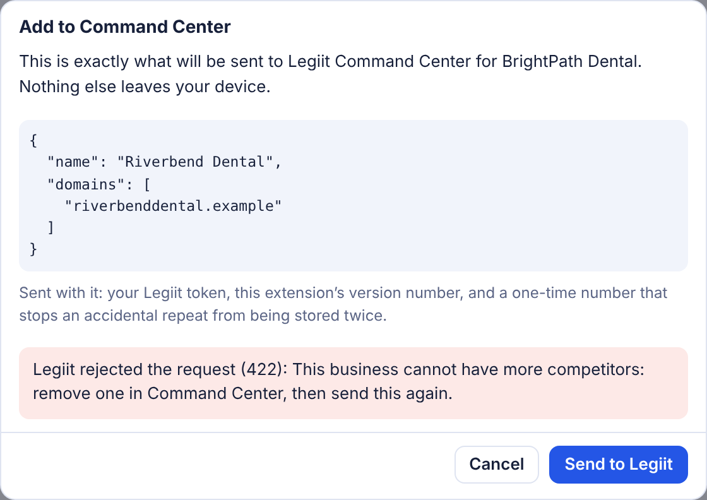

# Legiit Lens API: developer build guide

Contract version `1.0.0-draft.5`, 26 November 2026. What changed: [section 13](#13-version-and-changes). Best read on GitHub, which draws the diagram of section 2.

For the Legiit backend team. The Legiit Lens Chrome extension is finished and already calls this API. The API does not exist yet. This guide says what to build so that the extension works with it without another release.

- **"We" and "us" in this guide** are the extension team: the people who built the extension and this kit. Send your questions, and the answers that this guide asks for, to the person who gave you the kit, or open an issue in the repository.
- **Where the extension stands.** It is built and tested, and the API is live. The extension's first screen asks for an email address (endpoint 11) and then opens the tools; a 6-digit code from the email connects a free Legiit account (endpoint 12). Nobody gets past the first screen while endpoint 11 is down. Ask the product owner for the date of the store submission. The host of the API is decided: `lens.legiit.com` (decision 1). It must work by then.
- **The decisions in [section 11](#11-decisions-we-need-from-legiit) are open**, and most of them are for Product or Legal, not for you. The product owner has them on one page: [`decisions.md`](decisions.md).

| File | What it is |
| --- | --- |
| `README.md` | This guide: what to build, the rules for every endpoint, how to test |
| [`decisions.md`](decisions.md) | For the product owner: the decisions of section 11 in plain words, on one page |
| [`reference.md`](reference.md) | Every endpoint: fields, limits, meanings, examples. Generated from the contract |
| [`openapi.yaml`](openapi.yaml) | The contract (OpenAPI 3.1) |
| [`openapi.examples.json`](openapi.examples.json) | The same contract with the examples built in. Import this one into Postman, Insomnia or Swagger UI. It is OpenAPI 3.1: use tools that read 3.1 (Swagger UI 5 or later) |
| [`examples/`](examples) | 45 files. 12 request bodies built by the extension's code. 23 replies: the answers of the mock server, and replies for cases that the mock server does not have (integer ids, a session without capabilities, a save without a `url`). 10 error bodies |
| [`schemas/`](schemas) | The body of every POST as a standalone JSON Schema file (draft 2020-12), named `<operationId>.request.schema.json`. Generated from the contract, for teams that validate with a JSON Schema library |
| [`captured-requests.md`](captured-requests.md) | The raw requests Chrome sent in our tests: evidence for the header and CORS statements of section 3 |
| [`images/`](images) | Five screenshots of the extension, used in this guide. Made from the real extension by `npm run screenshots:kit` |
| `mock-server/` in the repository | A working reference implementation in Node (`npm run mock`) |
| `tests/api/` in the repository | The check you run against your API (`npm run api:check`) |

This folder is the specification. The mock server and the check are tools in the same repository: use them, but you do not need to read their code to build the API. If two files ever disagree, `openapi.yaml` is right. Tell us, so we fix the other one.

### Get the tools

**This folder does not work alone.** The mock server, the check and the extension are in the repository that this folder belongs to.

- The repository is `parallax1978/legiit-chrome-extension` on GitHub, branch `claude/trusting-johnson-vz4bsi`. This folder is `docs/legiit-api/` in it. If you cannot open the repository, ask the person who gave you this kit for access.
- You need Node 22 or later. `npm install` in the repository installs everything: about 1 GB and a few minutes.
- If you received only this folder, or a document made from it, you can read and plan. You cannot run `npm run mock` or `npm run api:check`, and you cannot build the extension. Get the repository before you start to build.

### What the extension does

Legiit Lens adds a side panel to Chrome: a panel that opens next to the page. It measures the page that is open and shows the result in five tabs. A sixth tab holds the settings. The first screen asks for an email address (endpoint 11), and then every tool works. A 6-digit code from the email connects a free Legiit account (endpoint 12). Once it is connected, the tabs get buttons that send a result to Legiit, as far as the account's plan includes them:

| Tab | What the user sees | What it sends to Legiit |
| --- | --- | --- |
| Click Potential | On a Google results page: how far down the first normal result starts, and what fills the screen above it | A visibility snapshot (endpoint 4) |
| Why Not Me | On a Google results page or in an AI answer: the places where a competitor is named and the user's own brand is not | A gap list (endpoint 5) |
| Rewind | What changed on a page over time, read from the Wayback Machine | Nothing. It reads the dates of search-industry events (endpoint 9) |
| New or Noise | Which sentences of a text say something that competing pages do not say | A content analysis (endpoint 7) |
| Instant Brief | A client brief, written from the website of a business | A workspace (endpoint 8) |

The Settings tab, which also opens as a page of its own, holds the token, the chosen business, the user's own brands and their competitors (endpoints 1, 2, 3 and 6). Each tab can also ask Legiit's AI to rewrite its text (endpoint 10). Words such as "business", "snapshot" and "gap" are explained in [section 14](#14-words-used-in-this-kit).



*The side panel while a Google results page is open: the five feature tabs and Settings. On the Click Potential tab, the button "Save to Command Center" starts the save of a visibility snapshot (endpoint 4).*

## 1. What to build

Twelve HTTPS endpoints, and pages in Command Center.

| # | Method and path | What it does | Capability |
| --- | --- | --- | --- |
| 1 | `GET /v1/session` | Checks the token. Returns the user, the plan and the enabled features | always on |
| 2 | `GET /v1/businesses` | Lists the user's businesses | `businesses` |
| 3 | `GET /v1/businesses/{businessId}` | Returns one business: brand names, domains, competitors | `businesses` |
| 4 | `POST /v1/businesses/{businessId}/visibility-snapshots` | Saves one measured Google results page | `visibilitySnapshots` |
| 5 | `POST /v1/businesses/{businessId}/gap-lists` | Saves a list of places where competitors appear and the business does not | `gapLists` |
| 6 | `POST /v1/businesses/{businessId}/competitors` | Adds a competitor to the business | `competitors` |
| 7 | `POST /v1/businesses/{businessId}/content-editor/documents` | Sends a content analysis of a page to the content editor | `contentEditor` |
| 8 | `POST /v1/workspaces/from-brief` | Creates a workspace from a client brief | `workspaces` |
| 9 | `GET /v1/industry-pulse` | Returns dated search-industry events | `industryPulse` |
| 10 | `POST /v1/ai/completions` | Rewrites a summary with Legiit's AI | `ai` |
| 11 | `POST /v1/signups` | Keeps the email address of the first screen as a lead and emails a 6-digit code to it. No token | always on |
| 12 | `POST /v1/signups/verify` | Checks the code, creates the account if there is none, and returns a token. No token | always on |

Besides the API, Command Center needs:

1. **A page where a user creates and revokes an API token.** The user pastes the token into the extension. See [section 6](#6-what-command-center-needs-besides-the-api).
2. **A page for each kind of saved item**, with a URL. Each save returns that URL in the field `url` of its reply, and the extension shows it as an "Open in Command Center" link.

### The whole job

The ten endpoints are the smaller part of the work.

| Part | What it is | Where to read |
| --- | --- | --- |
| The API layer | Ten endpoints with the token check, validation, storage and the error body | Sections 3 to 5, [`reference.md`](reference.md) |
| The token page | Create, list and revoke tokens in Command Center | Section 6 |
| Pages for saved items | Five kinds of item, each with a page behind its `url`. Someone has to design them | Section 6 |
| Industry Pulse | A stored list of dated events, and a way for a person to add one | Endpoint 9, decision 7 |
| AI | A model behind endpoint 10, an allowance per user, an agreement with the company that runs the model | Section 7, decision 6 |
| Personal data | Find and remove one person's details; delete everything with the account | Section 7, decisions 8 and 13 |
| Operations | The API host, a staging host, exceptions in the firewall and the rate limits, no logging of bodies | Sections 3, 7 and 8 |

The kit was tested by three test builds. Automated agents that had only this folder each built the API layer, one in Node, one in Python and one in PHP, and each passed the check of section 9, as it was on that day, on its first run. What they had to guess is now written in this guide. They did not build the pages in Command Center, a real data model, a real AI model or the operations part. So the kit is complete enough to build the API layer from it. The test builds say nothing about the size of the whole job.

### Before you start

- Get the repository ("Get the tools" above).
- **Thirteen decisions are open** ([section 11](#11-decisions-we-need-from-legiit)); decision 1, the host, is taken. Decisions 3, 4 and 10 block the build: ask for them first. For the others, the table names what to build until someone decides.
- Read sections 3 and 5 before you write the first route, and the part of section 8 for your framework.

### A build order

You can ship endpoint by endpoint. The extension shows only the features whose capability you list ([section 4](#4-capabilities-launching-endpoint-by-endpoint)). An order that works:

| Step | Build | Decisions it needs |
| --- | --- | --- |
| 1 | The API host and a staging host | 1, 12 |
| 2 | The token page and `GET /v1/session`. With `"capabilities": []` a user can connect already | 2, 5 |
| 3 | `GET /v1/businesses` and `GET /v1/businesses/{businessId}` | 10 |
| 4 | Competitors (endpoint 6): the smallest save. It needs the token check, the business check, the error body and the `Idempotency-Key` rule, which every other save uses too | none |
| 5 | Visibility snapshots and gap lists (endpoints 4 and 5) | 8 |
| 6 | Content analyses (endpoint 7) | 4 |
| 7 | Workspaces from a brief (endpoint 8) | 3 |
| 8 | Industry Pulse (endpoint 9) | 7 |
| 9 | AI (endpoint 10) | 6 |
| 10 | The pages behind `url`, then the launch list below | 9, 11, 13 |
| 11 | Sign-up from the extension (endpoints 11 and 12). Needed before the extension is published: without endpoint 11 nobody gets past the first screen | 14 |

Run `npm run api:check` after every step. Checks for a capability that you do not list yet are skipped.

### Two levels of done

**API done:** `npm run api:check` with the option `--other-business` passes against your API with all eight capabilities on: 34 checks pass and none is skipped ([section 9](#9-how-to-test)). The field `url` of a save reply may still be `null`.

**Launch done** is this list. The product owner signs it off.

1. "API done" holds on the production host.
2. Decisions 1 to 14 are answered, and we have what the list "What we need back from you" in section 11 asks for.
3. The token page exists. The pages for the five kinds of saved item exist, and every save returns a `url` that opens a real page.
4. The tests that the check does not cover are done (section 9, "Test these yourself").
5. The manual checklist of section 9 passes with the real extension against production. If steps 7 to 9 cannot be run because the extension does not recognise Google's page, the other steps are enough for the API.
6. The rules of section 7 are met. In particular: request bodies are not logged, the company that runs the AI model has agreed not to train on prompts and not to keep them, and the privacy policy names that company.
7. The test account for Google's reviewers exists (decision 11).

## 2. How the extension uses the API

If your viewer shows this diagram as code, read the table "What causes a request" below it: it says the same.



- **The first screen asks for an email.** Before the user clicks Start, the extension never contacts the API. The tools open as soon as Legiit has the address. The code from the email connects an account: a new one, or the one the address already has.
- **A POST is sent only after the user has seen the exact JSON body and confirmed it.** The extension never sends anything in the background. This is a promise in the extension's privacy policy.
- **Nothing is polled and nothing is retried automatically.**
- **The extension only writes.** It never reads a saved item back, never edits one and never deletes one.
- Only `GET` and `POST` are used. There are no query strings.



*The settings after Connect. The name and the plan come from `GET /v1/session`, the list of businesses from `GET /v1/businesses`, and everything marked "From Command Center" from `GET /v1/businesses/{businessId}`.*



*Before a save (here endpoint 6, a competitor) the extension shows the exact JSON body. It sends that body only when the user clicks "Send to Legiit".*



*After a save the extension shows "Saved" next to the button. "Open in Command Center" is a link to the `url` of your reply.*

What causes a request:

| The user… | Requests |
| --- | --- |
| enters an email on the first screen and clicks Start, or "Send a new code" | `POST /v1/signups` |
| enters the code from the email and clicks Verify | `POST /v1/signups/verify`, then `GET /v1/session` with the new token |
| clicks Connect, or "Try again" | `GET /v1/session` |
| opens the side panel or the settings page while a token is stored | `GET /v1/session` |
| has other extension pages open when the token changes | `GET /v1/session` from each of them |
| sees the settings screen while connected | `GET /v1/businesses` |
| chooses a business | `GET /v1/businesses/{businessId}` |
| opens the Rewind tab while connected | `GET /v1/industry-pulse` |
| confirms a save or an AI rewrite | one `POST` |

So a normal user causes a few requests per minute at most.

## 3. Rules for every request

### Base URL

- Production is `https://lens.legiit.com` (decision 1). Every path starts with `/v1`, at the root of the host: `https://lens.legiit.com/v1/session`.
- **The host must be final before the extension is submitted to the Chrome Web Store.** It is written into the extension's manifest as a required host. Changing it later makes Chrome disable the extension for every user until they approve the new host.
- HTTPS only in production.
- **No redirects.** Answer on the URL that was called. The extension never follows a redirect: it reports "Could not reach Legiit". The usual causes are a framework that adds or removes a trailing slash, a redirect to a canonical host, and a redirect to a login page.

### Authentication

- Every request except the two sign-up calls (`POST /v1/signups` and `POST /v1/signups/verify`) carries `Authorization: Bearer <token>`: the word `Bearer`, one space, the token. The token is the only credential. The word `Bearer` is case-insensitive.
- No cookies are sent. There is nothing to protect against CSRF: exempt these routes from CSRF checks.
- A token is printable ASCII without spaces, at most 4,096 characters. The extension refuses to store anything else.
- **Answer `401` only when the token itself is bad, as JSON with the error body.** A `401` with the error body on `GET /v1/session` makes the extension delete the token. Nothing in front of the API (a gateway, a proxy, HTTP Basic auth on a staging site) may answer `401` for a valid token, and it must never use that JSON shape. When the token cannot be checked because something of yours is down (the database, a login service), answer `503`.
- For a valid token `GET /v1/session` answers `200`. Say what the user's plan includes through `capabilities`, not through `403`. Use `403` on the session only when the account may not use the API at all (it is suspended, for example): the extension then shows your message and keeps a token that is already stored.
- The check sends every endpoint one request without a token and one with an unknown token. Each must answer `401` with the error body. An endpoint whose capability is off for the user may answer `404`, `405` or `501`.

### What arrives at the server

Captured from Chrome with a production build of the extension. The raw requests are in [`captured-requests.md`](captured-requests.md).

| Header | Value |
| --- | --- |
| `Authorization` | `Bearer <token>` |
| `Accept` | `application/json` |
| `Content-Type` | `application/json` (POST only) |
| `X-Legiit-Client` | `legiit-lens/<extension version>`, for example `legiit-lens/0.1.0`. For your logs: do not require it. The check sends one request without it |
| `Idempotency-Key` | A random UUID. On the five saves only, not on reads and not on AI. Do not require it. See [Saving the same thing twice](#saving-the-same-thing-twice) |
| `Cache-Control`, `Pragma` | `no-cache`. Chrome adds them, because the extension never uses a cached reply |
| `Origin` | `chrome-extension://<32 letters>` on POST. On GET only when the user has switched off the extension's access to the API host (see CORS below) |
| `User-Agent`, `Accept-Language`, `Accept-Encoding`, `Sec-Fetch-*`, `Sec-CH-UA*` | Chrome's own values |
| `Cookie`, `Referer` | never sent |

- Do not allow or block requests by `Origin` or `User-Agent`. The 32 letters are the extension's id, which is only known once the extension has been uploaded to the store.
- Do not put a browser challenge (CAPTCHA, JavaScript challenge, "checking your browser" page) in front of these routes. The extension cannot solve one.
- Exempt these routes from firewall rules that inspect request bodies. The bodies carry text read from web pages, which can look like HTML or SQL.

### CORS: not needed, but send it anyway

In the normal case Chrome sends no preflight `OPTIONS` request, and the extension works against a server that returns no `Access-Control-*` headers at all. The reason: the API host is one of the extension's host permissions.

A user can switch that permission off in Chrome ("Site access" in the extension's details). Chrome then sends a preflight before every request, as it does for a web page, and adds `Origin` to every request. We tested both cases: without CORS headers the extension cannot connect; with them everything works. So send them as a safety net:

```
Access-Control-Allow-Origin: *
Access-Control-Allow-Methods: GET, POST, OPTIONS
Access-Control-Allow-Headers: authorization, content-type, accept, x-legiit-client, idempotency-key
Access-Control-Max-Age: 600
```

The simple rule: send these headers on every reply, errors included, and answer `OPTIONS` on every path with `204` and these headers, without asking for a token.

What Chrome needs is less: `Access-Control-Allow-Origin` on every reply, and `Access-Control-Allow-Headers` on the reply to `OPTIONS`. A CORS middleware that sends exactly this is enough (Laravel's does, once it covers these paths: section 8). `Access-Control-Max-Age` only saves preflights, and `GET` and `POST` need no `Access-Control-Allow-Methods`.

Chrome adds `Cache-Control` and `Pragma` by itself and does not ask for them in a preflight, so they need not be in the list. Allowing every origin is safe here, because no cookies are used: without a token a request gets nothing.

The check warns when this safety net is missing. It sends two preflights and one `GET` with an `Origin` header. It looks for a `2xx` status, for `Access-Control-Allow-Origin` (`*` or the extension's origin), and on the preflight replies for the header names it asked for in `Access-Control-Allow-Headers`. There `*` does not stand for `authorization`: name it.

### Request bodies

- JSON, UTF-8, always one object.
- **Accept bodies of up to 1 MB** (1,048,576 bytes) on every POST. The extension never sends more. Raise the limit of your framework or proxy if it is lower (Express accepts 100 KB by default). You may answer `413` to anything larger.
- As sent (JSON without white space) the examples in this kit are 0.1 KB (a competitor), 1 to 3 KB (an AI request), 0.5 to 2.5 KB (a snapshot), 0.5 to 2 KB (a content analysis), 4 to 9 KB (a brief) and 0.5 to 11 KB (a gap list). The files in `examples/` are indented and therefore larger; the reference prints the size of each one as sent. Real bodies are often several times larger.
- **Any save can come close to 1 MB.** A gap list of 1,000 rows is about 0.5 MB, more with long titles or non-Latin text; the Markdown of a brief alone can be 600 KB. A body that would exceed 1 MB is not sent: the user is told that it is too large.
- Every required field is in every request. A field with no value is sent as `null`, `""` or `[]`, as its row in the reference says. **These are valid values: do not reject them as "missing".** One field can be absent: `responseSchema` of the AI request.
- Every text and every list has a maximum, stated in [`reference.md`](reference.md). The extension enforces them before sending, so you can size columns from them. It shortens what is too long instead of refusing it: text is cut and ends with "…", a list keeps its first entries. Every integer fits a signed 32-bit column.
- Lengths are counted in UTF-16 code units. If you check lengths, count characters (PHP `mb_strlen`, Laravel `max:`, Python `len`): a text within its limit in UTF-16 units is always within it in characters. Never count bytes (PHP `strlen`).
- All text is valid Unicode. It can contain any language, emoji and typographic quotes. An emoji is 4 bytes in UTF-8: a MySQL database needs `utf8mb4` for it (section 8).
- **Ignore fields you do not know.** A later extension version may add fields. Do not validate with "no additional properties".
- **Accept values you do not know** where the reference says "Values in this version": store the value as text. A later extension version may add values. Where the "Limits" column of the reference says "one of", the list is closed.
- Dates are ISO 8601 in UTC with milliseconds: `2026-11-20T12:00:00.000Z`. They come from the user's clock and say when something was measured, not when it was saved. Do not refuse a date for being in the past or in the future (the user's clock can be wrong), and record your own time of receipt. Store it in a column that holds any date with milliseconds (section 8 names the MySQL type).
- URLs are written the way browsers write them. They can contain characters that strict URI validators refuse (`|`, `[`, `]`). Check that a URL starts with `http://` or `https://` and is at most 2,048 characters long, and nothing more. One field, `rows[].contacts[].url` of a gap list, can also start with `mailto:`.
- **Before your server requests a URL from a request body, block private and internal hosts and IP ranges.** The URLs were read from web pages. Nothing in this API needs your server to request one.
- The check tests these rules on every save: it sends every value that can be empty as an empty value, a value that this version does not list in every open list, the URL `https://example.com/a|b?x=[1]`, and an emoji in a page title and in the Markdown of a brief.

What to validate:

| Level | What to check |
| --- | --- |
| Must | The body is one JSON object with the required keys in the right types. Otherwise answer `422` with the error body, or `400` for a body that is not JSON or not a JSON object; the extension treats the two alike. The check sends `{}`, an example with a text where a list must be, and a body that is cut off, to each of the five saves |
| Should | Everything in the "Limits" column of the reference: lengths, list sizes, number ranges, fixed values and closed lists ("one of") |
| Not needed | Rules that the reference writes as a sentence in the "Meaning" column, such as "null exactly when…" or "always the number of…". They describe what the extension sends. Do not reject a request because of them |

### Replies

- JSON, with `Content-Type: application/json` (a `charset` is fine), on the URL that was called. Also for errors: no HTML error pages, and no redirect to a login page.
- **The body is the object shown in the reference, at the top level.** No wrapper such as `{"data": …}`, and no bare array.
- **Keys are camelCase and case-sensitive.** An optional key under another spelling (`brand_names`, `focus_keywords`) is treated as absent, without any error in the extension. `npm run api:check` reports such keys.
- **Every list is a JSON array**, also when it is empty or filtered. In PHP, re-index a filtered array with `array_values` before encoding it.
- **A successful save must return a JSON body with an `id` at the top level.** `201` and `200` are both accepted. A `204`, an empty body or an HTML page is treated as a failed save: the user is told so and will probably send it again.
- An `id` can be a string or an integer, whichever your database uses. Send an integer larger than 2^53 − 1 as a string. Return the same id for the same thing everywhere.
- Text is a JSON string. Use `""` for empty text.
- An optional field can be left out or be `null`.
- You can add fields at any time. The extension ignores fields it does not know.
- Where the reference says "first N chars are used" or "first N items are used", you do not have to cut anything: the extension cuts what is longer. With more than 500 businesses, return only the 500 the user worked with most recently.
- Keep every reply under 5 MB. The extension does not read a larger one.
- Send `Cache-Control: no-store` on every reply, so that no proxy and no cache keeps a copy of a user's data. The check warns when it is missing.

The extension accepts more than this. A list entry that it cannot read (a business without an id, an event without a valid date) is skipped, and the rest of the list is used. So one bad row in your data does not break a user's screen. Do not rely on it: `npm run api:check` checks the strict form.

### Time limits and retries

- The extension waits **20 seconds** for the complete reply, **60 seconds** for `POST /v1/ai/completions`. Then it tells the user that Legiit did not answer. Your server is not told, and may still finish the work.
- Aim for under one second on reads and saves. The user is looking at a button that says "Sending…".
- The extension never retries on its own. The user can click again.

### Rate limits

- Limit each user, not each IP address and not all users together. A request without a valid token belongs to no user: if you limit such requests by IP address, allow the 20 that the check sends within a second.
- A starting point: 120 reads and 60 saves per minute for a user, and an AI allowance per day (decision 6). A `GET` is a read and a `POST` is a save. Count calls to the AI endpoint separately.
- Keep `GET /v1/session` out of tight limits. Every page of the extension calls it when it opens.
- Answer `429` with the error body, and say in the message when to try again. The extension does not read `Retry-After` and does not retry. An allowance that is used up is `429` too.
- The check in section 9 sends about 100 requests in a few seconds. With the token of the test account these are about 20 reads, 55 saves and 4 calls to the AI endpoint, of which 3 reach your model. The other 20 requests carry no valid token: you answer them with `401`. Exempt the test account from the rate limits and from the AI allowance, or allow for the check.

### Saving the same thing twice

A user can send the same save twice: from the same dialog after a timeout or an error, or by opening the dialog again later.

| Save | The same `Idempotency-Key` again | The same content under a new key |
| --- | --- | --- |
| Visibility snapshot | Return the first reply; store nothing | Store a new snapshot |
| Gap list | Return the first reply; store nothing | Store a new list |
| Content analysis | Return the first reply; store nothing | Store a new item |
| Competitor | Return the first reply; store nothing | Return the existing competitor's id with `200` |
| Workspace from a brief | Return the first reply; store nothing | The same `briefId` of the same user: update that workspace and return its id with `200` |

The column "The same `Idempotency-Key` again" is the `Idempotency-Key` rule. It is recommended, and the check warns when it is missing:

- Remember the reply of a **successful** save under (user, method, path, key) for 24 hours. Answer the same key with that reply again: same status, same body.
- Check the token, the capability and the business first. The remembered reply then takes the place of validating and storing the body.
- **Never remember an error.** After a `422`, `429` or `5xx` the dialog stays open, and the next click sends the same key with the same body. Handle that attempt as a new request. The check sends `{}` with a key and then a valid body with the same key, and warns when the valid body is not stored.
- Do not compare bodies. If the first request with a key is still running, wait for it or answer `409`; the extension shows a `409` like any other `4xx`. If you mark a key as running, let the mark end by itself after about 30 seconds: a request that died must not block the key for 24 hours.
- Do not require the header and do not check its format. The extension always sends a UUID (36 characters); `curl` and the check also send saves without it. An empty value means "no key". A key longer than 255 characters may be treated as no key, and you may store a hash of the key in place of the key.

The column "The same content under a new key" needs no key. Never de-duplicate snapshots, gap lists or content analyses by their content: the same reading saved twice is two items, and both carry the same `capturedAt`. The check fails when one of these three comes back with an id that an earlier save of the run got.

## 4. Capabilities: launching endpoint by endpoint

`GET /v1/session` returns a list of capabilities. The extension shows a feature only when its capability is in the list, and it never calls an endpoint whose capability is missing.

| Capability | What the user gets | Endpoints behind it |
| --- | --- | --- |
| `businesses` | The business drop-down in Settings, and tracked brands pre-filled from the chosen business. Every save into a business needs one to be chosen | 2, 3 |
| `visibilitySnapshots` | "Save to Command Center" on the Click Potential tab | 4 |
| `gapLists` | "Save to Command Center" on the Why Not Me tab | 5 |
| `competitors` | "Add to Command Center" next to a competitor in Settings | 6 |
| `contentEditor` | "Send to content editor" on the New or Noise tab | 7 |
| `workspaces` | "Open in Command Center" on the Instant Brief tab | 8 |
| `industryPulse` | Date shortcuts on the Rewind tab | 9 |
| `ai` | "Rewrite with Legiit AI" on four tabs, and "Improve drafts with Legiit AI" on the Instant Brief tab | 10 |

- The smallest useful launch is `GET /v1/session` returning `"capabilities": []`. The user can connect and sees no Legiit feature. Add capabilities as endpoints go live.
- Capabilities belong to the user: every token of a user gets the same list. Use them for plans too: leave out what the user's plan does not include.
- List `businesses` whenever you list one of the four capabilities below it in the table. Without it the user cannot choose a business, and those four saves stay disabled.
- Send the names exactly as written, in a JSON array. They are case-sensitive. The extension ignores a name it does not know, so a misspelt name hides its feature without any error. `npm run api:check` warns about unknown names.
- An endpoint whose capability is not in the user's session answers `404`, like an endpoint that does not exist. When you run the check with the token of an account on a smaller plan, it sends one request to each such endpoint. It fails when the answer is `403`, or `404` with the code `not_found`.
- The extension reads the capabilities when the side panel or the settings page opens. A page that stays open keeps the list it read: after a plan change the user sees the new features when they open the panel again.
- Safety net: if a save answers `404`, `405` or `501` although its capability is listed, the extension tells the user, then hides the buttons for it in that page until the page is opened again or the user connects again.

## 5. Errors

Every `4xx` reply has the same JSON body, including the errors your framework produces by itself (validation, throttling, authorisation, a missing record, a body that is too large):

```json
{ "error": { "code": "not_found", "message": "No such business" } }
```

Exceptions:

- A `404` or `405` for an unknown path, a wrong method or an endpoint whose capability is off can have any body or none. If it has the error body, its code must not be `not_found`.
- A `413` from a proxy in front of your application can be the proxy's own page (nginx sends HTML). The extension never sends more than 1 MB.
- The body of a `5xx` is not read.

`message` is one sentence the user can act on. It is shown after the status code, as plain text, up to 200 characters, for every `4xx` except `401` and except a `404` or `405` that means "not available". On screen it reads, for example, "Legiit rejected the request (422): keyword is required".



*When your API answers `422`, the dialog stays open and shows your `error.message` after "Legiit rejected the request (422):". The message in this image is an example.*

| Status | Use it when | What the extension does |
| --- | --- | --- |
| `401` | The token is missing, unknown, expired or revoked. Nothing else | On `GET /v1/session`, when it carries the error body: deletes the token and asks for a new one. Elsewhere: shows "Legiit did not accept the token" |
| `403` | The token is valid and the user has the feature, but another rule of yours refuses this one request: the user's role in this business does not allow this kind of save, or the account may not use the API now (it is suspended, for example). Not for a feature the user does not have (leave the capability out), not for a business that the user may not save into at all (`404` `not_found`), not for an allowance that is used up (`429`) | Shows "Legiit rejected the request (403)" and your message. Keeps the token |
| `404` with `error.code` `"not_found"` | The business in the path does not exist or is not this user's | Shows "Legiit could not find it (404)" and your message. The feature stays |
| any other `404`, `405`, `501` | The endpoint is not built, or its capability is not enabled for this user | Says that Legiit cannot receive this yet, then hides that button |
| `422`, `400`, `413`, any other `4xx` | The body cannot be accepted | Keeps the dialog open, shows "Legiit rejected the request (422)" and your message |
| `429` | Too many requests, or an allowance that is used up (section 3, "Rate limits") | Shows your message. Does not read `Retry-After`, does not retry. Say in the message when to try again |
| `5xx` except `501` | Something failed on your side | Shows "Legiit had a problem" and the status. Does not retry |

The third column describes a save. For the other calls the extension shows less:

| Call | When it fails |
| --- | --- |
| `GET /v1/session` at Connect | The reason is shown, and nothing is stored: the user clicks Connect again |
| `GET /v1/session` when a page opens | Only a `401` with the error body deletes the token. For anything else the token is kept, the panel shows "Legiit not connected" with the reason, and Settings offers "Try again". No other call is made meanwhile |
| `GET /v1/businesses` | Not built: the drop-down is hidden. Any other failure: the reason is shown under it |
| `GET /v1/businesses/{businessId}` | The reason is shown; what was pre-filled before stays |
| `GET /v1/industry-pulse` | No date shortcuts, no message |
| `POST /v1/ai/completions` | The built-in text stays, with one line that says why. After a `404`, `405` or `501` the button goes away |

Four things to get right:

1. **The two kinds of 404.** "This business does not exist" must carry `"code": "not_found"`, on every path with a business id. Without that code, the extension treats a deleted business as an endpoint that is not built: the user reads "Legiit cannot receive this yet" and the save button then disappears. An id that cannot exist in your scheme (text where you use numbers) should get the same answer, and must never cause a `500`.
2. **`not_found` is reserved for a missing business.** An unknown path, a wrong method or a switched-off capability must use another code, or no body at all. Check what your framework puts in its own 404.
3. **Never `401` for anything but the token.** The extension takes a `401` for your API's own verdict only when its body has `error.code` as text; any other `401` keeps the token and offers "Try again".
4. **A business that belongs to another user is `404` `not_found`**, the same as one that does not exist. Do not reveal that it exists.

When several errors apply at once, any order passes the check. The mock answers in this order: token (`401`), body size (`413`), JSON syntax (`400`), endpoint and capability (`404`), business (`404` `not_found`), fields (`422`). Rate limiting (`429`) can come anywhere after the token.

## 6. What Command Center needs besides the API

### Sign-up from the extension

Endpoints 11 and 12. The first screen of the extension has one field, an email address, and a Start button.

1. **Start (endpoint 11):** keep the address as a lead with the source "Legiit Lens", and email a 6-digit code to it. Create no account. Answer `202`. The extension opens its tools at once.
2. **The code (endpoint 12):** the user types the code into the extension. If it is right, create a free account (no password yet) and answer `201` with a token, or, for an address that already has an account, answer `200` with a new token for that account. Send a new account a welcome email with a link to set a password.

- **An account exists only after a code came back,** so an address that nobody reads never becomes one. A flood of sign-ups adds leads and emails, not accounts.
- **Answer Start the same way whether or not the address has an account.** The code proves that the person reads that inbox, so it can connect an existing account too.
- **Limit both calls per IP address and per email address,** for example one code per address per minute and five per hour. A code is valid for 30 minutes, a new code replaces the old one, and after five wrong codes the code stops working.
- **A new account has no business yet,** so the saves into a business stay hidden until it has one. Which features it gets is decision 14.
- The conformance check does not call these endpoints: every call sends an email. Test them yourself (section 9).

### A page for API tokens

- The user creates a token, sees it once, copies it and pastes it into the extension's settings. The user can see their tokens (name, created, last used) and revoke each one.
- A token acts as one user. It reaches every business that user may save into: their own, and those shared with them.
- Format: printable ASCII without spaces, well under 4,096 characters. We suggest a recognisable prefix (for example `lgt_`) followed by at least 32 random bytes in base64url, so that leaked tokens can be found by secret scanners.
- Store only a hash of the token. Use a plain SHA-256 of the token, so that the row can be found by its hash; a password hash such as bcrypt cannot be looked up.
- Make tokens long-lived and revocable. The extension has no refresh: an expired or revoked token answers `401`, and the user must paste a new one.
- There is no logout call. Disconnecting in the extension sends nothing: it deletes the token, the chosen business and what was pre-filled from it, on the device.
- Tell us the URL of this page, so that a later extension release can link to it.
- OAuth is not needed for version 1. The extension keeps authentication behind one interface, so OAuth can be added later without changing the endpoints.

### A page for every kind of saved item

Each save returns `url`: the absolute URL of a page in Command Center that shows the saved item. The extension shows it as a link next to "Saved". A click opens it in a new tab, without the token, so the page must work with the user's normal Command Center login. **Return a `url` only when the page really exists.** Until then return `"url": null`: the extension shows "Saved" without a link, and the check warns. The check cannot open a link; it only reports where the links point.

What each page has to show, as a minimum:

| Saved item | Minimum content of its page |
| --- | --- |
| Visibility snapshot | Keyword, date, Google site and window size; the grade, marked as an estimate; what fills the first screen; the organic results with their positions; where the tracked brands rank |
| Gap list | Source, question and date; one line per row: where the gap is, the page, the competitors named, the reason, and the contact links |
| Competitor | The competitor's own page, or the business's list of competitors with the new one in it |
| Content analysis | Keyword, page and date; "Only on this page" (the sentences nobody else makes); "Missing points" with their source links |
| Workspace | The brief: render its `markdown` |

For a workspace the link matters most: the button that starts the save is called "Open in Command Center", so the user expects to land in the new workspace.

## 7. Privacy and security rules

What is promised to users, and to Google for the Chrome Web Store listing, depends on the backend too. The promises are in the extension's privacy policy, [`store/privacy-policy.md`](../../store/privacy-policy.md) in the repository.

### Promises of the company

These three bind Legiit as a company, not only the code. They are for Product and Legal (decisions 6 and 13):

- **Use the data only for the feature the user asked for.** No advertising, no sale, no profiling. The extension's privacy policy says so under Google's "Limited Use" rules.
- **People at Legiit do not read saved items**, except with the user's consent, for security, or where the law requires it. This limits what support tools and admin screens may show.
- **If the AI model is run by another company**, that company processes the prompt for Legiit: it must not train on it or keep it. Many standard terms keep prompts for some days, so this needs an agreement. The extension's privacy policy must name the company before launch.

### Rules for the code

- **Everything in a request body except the user's own typing was read from web pages by a program.** Treat every text as untrusted: escape it when you show it, never run it, never use it to build a query.
- **The Markdown of a brief quotes web pages.** Render it with raw HTML and unsafe links switched off: `[x](javascript:…)` is a link, not raw HTML.
- **Gap lists can contain personal data of third parties:** names and e-mail addresses of authors and site contacts. The extension found them on public pages when the user clicked "Scan sources". They are in `rows[].contacts`: a `label` can be a name, a `url` can be a `mailto:` address.
- **Briefs can contain it too:** the published contact details of a business (`contact`), and in `markdown` the same details again plus the site's testimonials with the names of its customers.
- **Store personal data so that one person's details can be found and removed on request.** For a brief that means replacing or deleting the whole brief, because its Markdown is not to be parsed. Apply your retention rules, and delete everything with the account.
- **Check on every request that the business belongs to the token's user.** `businessId` comes from the client, and it can be stale: the business may have been deleted or un-shared since the user chose it, and the choice is kept when the same user connects with a new token.
- **Look up `briefId` and `Idempotency-Key` per user**, never across users. Both are made on the user's device.
- **The AI endpoint accepts a system prompt and a prompt from the client.** Anyone with a token can send their own. Limit use per user, enforce the length limits in the contract, cap the output tokens, and give the model no tools and no access to other data. The facts between `<facts>` tags were read from web pages and can contain text that tries to instruct the model.
- **Do not log `Authorization` headers, and keep request bodies out of logs, support tools, error trackers and analytics.** Tools that record requests do it by default (section 8). If you must log a body, treat the log like the data.
- **Limit each user's requests** (section 3, "Rate limits").

## 8. Notes for your framework

Defaults of common frameworks that break this API. The check in section 9 catches most of them. Read "Every framework", then the part for yours.

### Every framework

| Trap | What to do |
| --- | --- |
| The framework answers an unknown route, a failed validation, a rate limit or a missing record in its own shape | Convert every error for `/v1/*` to the error body of section 5, in one place: a render callback in Laravel's exception handler, a final error middleware in Express, a custom exception handler in Django REST Framework |
| The framework's own "not found" is used for a missing business | Look the business up yourself, among the businesses of the token's user, and answer `404` with the code `not_found` yourself. Every `404` that the framework makes by itself then gets another code |
| An integer route parameter (`whereNumber`, `<int:id>`) makes the framework answer its own 404 for an id of another form | Take the id as text and check it in your business lookup. When your ids are numbers, the check sends three ids of another form: a text, your business id followed by letters (`101abc`), and a number of 20 digits. A `4xx` other than `404` `not_found` is a warning; a `401`, a `5xx` or a success is a failure |
| CSRF middleware, a CORS allow-list by origin | Exempt these routes from CSRF; allow every origin (section 3) |
| A body limit below 1 MB | Accept 1 MB on every POST. `express.json()` accepts 100 KB. The default of nginx (`client_max_body_size 1m`) is exactly enough: do not lower it. PHP accepts 8 MB |
| A staging site behind HTTP Basic auth | It cannot work: the `Authorization` header carries the token, so Basic auth answers `401` to every call and the extension can never connect |
| A redirect that adds a trailing slash, or sends an unauthenticated call to a login page | Switch it off for these routes: answer `401` as JSON |
| A helper that builds links from the host of the request (`url()`, `route()`, `build_absolute_uri()`) | With the API on a host of its own, every `url` you return would point to the API host. Build `url` from a configured base URL of Command Center |
| A tool that records requests (Laravel Telescope, Sentry, an APM agent, access logs with bodies) | Such tools can store request bodies and headers. Switch off bodies and the `Authorization` header for `/v1/*` (section 7) |
| A time limit of 60 seconds in the web server (nginx `fastcgi_read_timeout`, `proxy_read_timeout`) | The extension also waits 60 seconds for the AI endpoint. Give each call to the model about 25 seconds, so that two tries end before both limits |

### Laravel and PHP

| Trap | What to do |
| --- | --- |
| Routes in `routes/api.php` get the prefix `/api` | Remove the prefix (`apiPrefix: ''` in `withRouting()` from Laravel 11; `Route::prefix()` in `RouteServiceProvider` before), or keep it and tell us a base URL that ends in `/api`. The patterns below then read `api/v1/*` |
| The `required` rule refuses `""` and `[]` | Use `present`, with `nullable` where the reference allows `null` |
| The global middleware `ConvertEmptyStringsToNull` turns `""` into `null`, and `TrimStrings` removes white space at both ends of `markdown`, `prompt` and `system` | Switch both off for these routes. From Laravel 11, in `bootstrap/app.php`: `$middleware->convertEmptyStringsToNull(except: [fn ($request) => $request->is('v1/*')])`, and the same with `trimStrings`. In Laravel 8 to 10, in a service provider: `ConvertEmptyStringsToNull::skipWhen(fn ($request) => $request->is('v1/*'))`, and the same with `TrimStrings`. `withoutMiddleware()` on a route does nothing here, because both are global |
| `JsonResource` and resource collections wrap the reply in `"data"`, and model arrays have keys in snake_case (`brand_names`) | Call `JsonResource::withoutWrapping()`, return no paginated collection, and name every key in camelCase yourself |
| The `api` middleware group limits all routes together to 60 requests a minute (`throttle:api`: a default up to Laravel 10, optional later) | Define your own limits with `RateLimiter::for` (section 3, "Rate limits"). The check alone sends about 100 requests in a few seconds |
| `config/cors.php` covers only `api/*` | Add `v1/*` to `paths`, allow every origin and set `max_age` |
| `auth:sanctum` answers a bad token with `{"message": "Unauthenticated."}`, and sends a request without `Accept: application/json` to the login route | Convert it to the error body (example below): without the error body the extension does not delete a revoked token. Sanctum's personal access tokens fit section 6: they are stored as SHA-256, have a last-used time, can have a prefix (`token_prefix`), and do not expire by default |
| `Str::markdown()` passes raw HTML and unsafe links through | `Str::markdown($md, ['html_input' => 'escape', 'allow_unsafe_links' => false])` |
| PHP encodes a filtered array as an object | `array_values()` before `json_encode` |
| `JSON_NUMERIC_CHECK` turns the text `"365"` into a number | Do not use it. Names and keywords are text |
| Wildcard rules (`rows.*.contacts.*.url`) can be slow on the largest gap list: 1,000 rows with up to 18 contacts each | The summary of the check prints how long the save of about 1 MB took. If it is slow, check the rows in a plain loop, or validate with a JSON Schema library and the files in [`schemas/`](schemas) |

One place for the error body, as a sketch:

```php
// bootstrap/app.php, from Laravel 11. Up to Laravel 10 the same callback goes into register() of
// app/Exceptions/Handler.php: $this->renderable(function (Throwable $e, Request $request) { ... });
->withExceptions(function (Exceptions $exceptions) {
    $exceptions->render(function (Throwable $e, Request $request) {
        if (! $request->is('v1/*') || $e instanceof HttpResponseException) {
            return null; // Laravel's own handling: the rest of the site, and a response you threw yourself
        }
        [$status, $code, $message] = match (true) {
            $e instanceof ValidationException => [422, 'invalid', $e->validator->errors()->first()],
            $e instanceof AuthenticationException => [401, 'unauthorised', 'The token is missing or not valid.'],
            $e instanceof ThrottleRequestsException => [429, 'rate_limited', 'Too many requests. Try again in a minute.'],
            $e instanceof HttpExceptionInterface => [$e->getStatusCode(), 'http_error', 'The request cannot be handled.'],
            default => [500, 'server_error', 'Something went wrong on our side.'],
        };

        return response()->json(['error' => ['code' => $code, 'message' => $message]], $status);
    });
})
```

An unknown route and a failed route-model binding both arrive in this callback as the same `NotFoundHttpException`. So do not bind the business in the route. Look it up in a middleware, and return the answer for a missing business from there:

```php
return response()->json(['error' => ['code' => 'not_found', 'message' => 'No such business']], 404);
```

### MySQL

| Trap | What to do |
| --- | --- |
| A `TEXT` column holds 64 KB | `markdown` of a brief can be 600 KB, and any save stored as one JSON value can be close to 1 MB: use `MEDIUMTEXT` or a JSON column |
| The character set `utf8` holds 3 bytes per character | An emoji in a page title then causes a `500` or cut text. Use `utf8mb4` for the tables and for the connection |
| A `TIMESTAMP` column ends in January 2038 and has no milliseconds | Use `DATETIME(3)` for the dates of a request (`capturedAt`, `createdAt`). A wrong clock on the user's device must not cause a `500` |
| MySQL reads the text `'12abc'` as the number 12 when it compares it with an integer key | Check that an id from the path has only digits before you query. If not, answer `404` `not_found`. The check sends your business id followed by `abc`: a `200` fails it |

### Express

| Trap | What to do |
| --- | --- |
| `express.json()` accepts 100 KB | `express.json({ limit: '1mb' })` |
| A body that is not JSON, or is too large, reaches the error middleware as an error of the body parser (`entity.parse.failed`, `entity.too.large`) | Answer `400` and `413` with the error body there |
| `req.params` are text | An integer key needs the same check of the id as in the MySQL table above |

### Django and Django REST Framework

| Trap | What to do |
| --- | --- |
| A route written with a trailing slash: `APPEND_SLASH` then redirects `/v1/session` to `/v1/session/`, and the extension never follows a redirect | Write these routes without a trailing slash (`path('v1/session', …)`) |
| `SessionAuthentication` checks CSRF | Use only your token authentication on these views |
| A `CharField` refuses `""` | `allow_blank=True`, and `allow_null=True` where the reference allows `null` |
| Serializer fields are named in snake_case, and a pagination class wraps a list in `{"count": …, "results": […]}` | Name the fields in camelCase; use no pagination on these views |
| Errors have their own shapes (`{"detail": "…"}`, `{"field": ["…"]}`) | A custom `EXCEPTION_HANDLER` that returns the error body |

## 9. How to test

You need Node 22 or later and the repository ("Get the tools" at the top of this guide). The first two parts need no Chrome.

```bash
npm install
```

This installs the extension's whole toolchain: about 1 GB and a few minutes.

### See the reference behaviour

```bash
npm run mock
```

This starts the mock API on `http://localhost:8787` (for another port: `PORT=8788 npm run mock`, in PowerShell `$env:PORT=8788; npm run mock`). It implements the contract with an in-memory store and checks every request body against the contract. Tokens: `demo-token` (a user with every capability), `limited-token` (a second user with three). The business `biz_harborview` belongs to the second user alone: the token of the first user gets `404` `not_found` for it. Any other token is refused with `401`.

```bash
curl -s http://localhost:8787/v1/session -H "Authorization: Bearer demo-token"
```

```bash
curl -s -X POST http://localhost:8787/v1/businesses/biz_brightpath/gap-lists -H "Authorization: Bearer demo-token" -H "Content-Type: application/json" --data @docs/legiit-api/examples/saveGapList.request.json
```

In PowerShell write `curl.exe` instead of `curl`, and put the `@…` argument in quotes.

The code is in `mock-server/handlers.mjs`, about 350 lines. Its header lists where the main rules of this guide are implemented. Read it when the prose is unclear. Its health page (`/health`) and its tolerance for a trailing slash are conveniences, not part of the contract.

### Check your API

```bash
npm run api:check -- https://your-staging-host your-test-token
```

The command is the same in bash, PowerShell and cmd. Write the `--` before the arguments: without it npm keeps the options for itself. The first line of the summary says whether the run was read-only, so you can see that the options were read.

The token can come from the environment variable `LEGIIT_API_TOKEN` instead. Use this form in a build pipeline and wherever the output is kept: npm prints the command line, the token included, and writes it into its log file. The check does not print the token. When a reply of your server repeats the token, the check shows `<token>` in its place.

```bash
LEGIIT_API_TOKEN=your-test-token npm run api:check -- https://your-staging-host
```

In PowerShell: `$env:LEGIIT_API_TOKEN='your-test-token'; npm run api:check -- https://your-staging-host`.

- It sends the example requests with the extension's own client code, and checks every reply against the contract and against what the extension accepts. 34 checks, a few seconds, about 100 requests.
- **It creates data** in the account, 28 items in a full run: 7 snapshots and 6 gap lists (most for the keyword "best dentist in austin"; one gap list is about 1 MB, one comes from a pasted answer and has an empty subject), 5 content analyses, 4 competitors and 6 workspaces (one with 600 KB of Markdown). Competitors and workspaces are named "Conformance Check: …". The summary lists every id. It also lists an item that a wrong server stored by mistake, with the reason in capital letters. Use a test account with at least one business.
- Add `--business=<id>` to choose the business. Without it the first business of the list is used.
- Add `--read-only` for a run that sends no save at all. It still calls the AI endpoint six times: four times with the token (three of these calls reach your model) and two times without a valid token.
- Add `--other-business=<id>`, with the id of a business of **another** user, to check that this token cannot reach it. Without it that check is skipped; "API done" needs it. In a full run it also tries four saves into that business, which a correct server refuses. If one goes through, the check fails and the summary names the item, so that it can be removed. To try it against the mock, use `--other-business=biz_harborview`.
- Checks for a capability that the session does not list are skipped, so you can run it from the first endpoint on. A run with skipped checks proves only the checks that ran.
- It ends with a summary. Its first line is the mode. Then come the account and its capabilities, the requests it sent, how long the two largest saves took, what it created, where the returned links point, the warnings, and every check that was skipped, with the reason. Its last line is the result. A failure means the reply breaks the contract; most failures would show an error to a user. A warning is a recommendation, for example a missing `url`.
- The exit code is `0` when no check failed (warnings and skipped checks do not change it), `1` when at least one check failed, and `2` when the check could not start or ended without a result. So `0` always means that the checks ran and none failed, and the check can run in your build pipeline.
- **It has no clean-up**, because the API has no call that deletes. Run it in a business that exists only for testing, and remove that business or the items on your side afterwards.

To see it pass, run it against the mock in a second terminal:

```bash
npm run api:check -- http://localhost:8787 demo-token
```

The check does not cover everything. Test these yourself: the sign-up (Start answers `202` and an email with a code arrives; the right code gets `201` and a token for a new address, `200` and a token for an address with an account; a wrong code `422`); rate limiting; a body larger than 1 MB; a body near 1 MB on the snapshot, competitor, content-analysis and AI endpoints (the check sends its large bodies to the gap-list and the workspace endpoint only); the same `Idempotency-Key` after a `429` or a `5xx` (the check tries it after a `422` only); a token that was revoked or has expired (the check uses a token that never existed); an endpoint whose capability is off, if you did not run the check with an account on a smaller plan; whether a save is really stored and shown (the check reads back competitors only); whether the links you return open a real page; what the AI endpoint does when the model is slow or returns broken JSON; and everything in section 7.

### Check with the real extension

Do this once the check above passes. Your team runs this list against staging: it needs Chrome and the repository, and no knowledge of the extension's code. For "Launch done" it is run once more against production.

```bash
LEGIIT_API_BASE_URL=https://your-staging-host npm run build
```

In PowerShell, set the variable first: `$env:LEGIIT_API_BASE_URL='https://your-staging-host'; npm run build`.

Then open `chrome://extensions`, switch on Developer mode, choose "Load unpacked" and select the `dist` folder. Use this build to count requests too: in development mode (`npm run dev`) every read is sent twice.

1. Open the side panel for the first time. It asks for an email: enter a new one and click Start. The tools open. Type the code from the email and click Verify: "Legiit connected" appears. In the extension's settings, click Disconnect, paste a token of your test account and click Connect. Your name and plan appear.
2. Choose a business. Its brand appears under "My brands" and its competitors under "Competitors", marked "From Command Center".
3. In Settings, under "Competitors", click "Add a competitor", type a name, then click "Add to Command Center", read the JSON, click "Send to Legiit". "Saved" appears with a link that opens the item.
4. Open the website of any business and click the extension's icon. On the Instant Brief tab click "Build brief", then "Open in Command Center", and send. The link lands in the new workspace. With the `ai` capability on, also click "Improve drafts with Legiit AI".
5. On the New or Noise tab choose "Pasted text" and paste a few paragraphs. Under "Compare against" choose "Pasted URLs", paste the URLs of two articles, and click "Compare"; Chrome asks once whether the extension may read those sites. Then click "Send to content editor", read the JSON, click "Send to Legiit", and open the link next to "Saved".
6. Open the Rewind tab, enter the URL of a page that has existed for some years, and click "Look up history"; Chrome asks once whether the extension may read the Wayback Machine. Above the timeline, "Industry Pulse dates" shows the dates of your events.
7. Open a Google results page and click the extension's icon. On the Click Potential tab click "Save to Command Center", read the JSON, click "Send to Legiit", and open the link next to "Saved".
8. On the same tab click "Rewrite with Legiit AI". The dialog "Send to Legiit AI?" opens: read the JSON, click "Send". The summary is replaced by your model's text.
9. Search Google for something where one of the business's competitors ranks (the competitor's name works). On the Why Not Me tab the gap list has rows: click "Save to Command Center" above it, send it, and open the link next to "Saved". Without Google: open "Paste an answer instead" on that tab and paste a text that names a competitor.
10. Revoke the token in Command Center. Close the side panel and open it again, or reload the settings page. It says that the token was not accepted and asks for a new one.
11. With a token of user A, save into a business of user B (change the business id in a `curl` call). The answer is `404` `not_found`.

Steps 7 to 9 need the extension to recognise Google's page. If it says "This results page was not recognised", that is a matter for the extension team, not for the API: tell us, and rely on the other steps.

To see what the extension sent and received: right-click inside the side panel (or the settings page), choose Inspect, and open the Network tab. Do this before you click, so the request is recorded.

## 10. Questions developers ask

Every question here came up in one of the test builds.

| Question | Answer |
| --- | --- |
| A trailing slash, a query string? | The extension sends neither. Do what your framework does, without redirecting |
| What do I answer for an unknown path, or a known path with another method? | `404` or `405`, with any body or none. If you send the error body, use any code except `not_found` |
| How exactly does the `Authorization` header look? | `Bearer`, one space, the token. Answer `401` to anything else |
| Do a missing, an unknown and a revoked token need different `401` bodies? | No. The extension shows none of it |
| Must I refuse a request without `Content-Type: application/json`? | No. The extension always sends it |
| `WWW-Authenticate` on a `401`? | Optional. The extension ignores it |
| May replies be compressed? | Yes. Chrome sends `Accept-Encoding` |
| What is in the body of a `5xx`? | Anything. It is not shown |
| `400` or `422`? | `400` for a body that is not JSON or not a JSON object (an empty body included), `422` for a JSON object that breaks the contract. The extension treats them alike, and the check accepts either |
| What does my `error.message` look like on screen? | "Legiit rejected the request (422): " followed by your sentence. Name the first problem; a full stop at the end is up to you |
| Do I store fields I do not know? | Your choice. Accept the request either way |
| A date without milliseconds, or with an offset? | The extension always sends UTC with milliseconds and `Z`. Accept at least that form; a parser that accepts more is fine |
| Is `10.0` an integer? | Accept it or refuse it, as your framework does. The extension never sends a fraction |
| Does a save into a business also need the `businesses` capability on the server? | No. Each endpoint checks its own capability |
| When would I use `403`? | Perhaps never. It is for one request that another rule of yours refuses: the user's role in this business does not allow this kind of save, or the account may not use the API now (it is suspended, for example). For a feature the user does not have, leave the capability out. An allowance that is used up is `429`. A business that the user may not save into at all is `404` `not_found` |
| A business the user can see but not save into? | Do not list it in `GET /v1/businesses`. A save into it is `404` `not_found`, like any business that is not theirs to save into |
| How do I compare competitor names and domains? | With simple rules. Names: lower case, without surrounding spaces. Domains: lower case, without scheme, `www.` and path. The extension sends plain host names, so ports and other special cases do not occur. A domain that another competitor of the business already has stays with that one: no two competitors of a business share a domain. When no name matches, go through the domains of the request in their order: the first domain that a competitor of the business already has decides, and you return that competitor |
| Do the competitors of a brief become competitors of a business? | No. They stay inside the brief |
| A business has 200 competitors and the user adds another? | Your decision. If you refuse, answer `422` with a message |
| Must a competitor that was added appear in Business Details at once? | Yes, among the first 200: the extension reads no more. The check fails when the competitor is not listed, or is listed with damaged text. It warns when the business has 200 competitors or more |
| Does a workspace have to appear in `GET /v1/businesses`? | Not for the extension. It is decision 3 |
| Which keys of `responseSchema` must I support? | `type`, `properties`, `required`, `items`, `minItems`, `maxItems`, `additionalProperties`. Pass the schema to the model's structured-output option, or put it into the prompt |
| A `responseSchema` with a task other than "brief"? | The schema decides: return JSON whenever it is present |
| `maxOutputTokens` is above my maximum? | Use your maximum. Do not refuse the request. The extension sends 700 or 2,000 |
| `responseSchema` is `null`? | The extension never sends that. Treat it as absent, or answer `422` |
| `503` or `504` when the model provider fails? | Either |
| What does `model` in the AI reply have to be? | Any text, or leave it out |
| Should I validate the model's JSON before returning it? | Check that it parses; checking it against the schema is optional. If it does not parse, or the model returns nothing, ask the model once more, then answer `502`. Both tries together must end before the extension stops waiting (60 seconds): give each call to the model about 25 seconds |
| How many Industry Pulse events do I return? | The latest 20 are plenty. The extension shows 8 |
| What counts as a read and what as a save for rate limits? | A `GET` is a read, a `POST` is a save. Count calls to the AI endpoint separately (section 3, "Rate limits") |
| How do I remove what the check created? | On your side. The API has no call that deletes. The summary of the check lists the id of every item (section 9) |
| How exact must my length checks be? | Counting characters is enough: it never refuses a valid request. Never count bytes (section 3). The exact count is in UTF-16 units, in Python `len(s.encode('utf-16-le')) // 2` |
| Is there an API to create tokens? | No. Tokens are created on a page in Command Center |
| How does the extension notice that a token was revoked? | The next save shows "Legiit did not accept the token". The token is deleted the next time the panel or the settings page opens |
| Can one extension talk to staging and production? | No. The host is built in. A staging test needs its own build (section 9) |

## 11. Decisions we need from Legiit

Most of these decisions are for Product or Legal. The product owner has them in plain words on one page: [`decisions.md`](decisions.md). Each row has a recommendation that can be built today. If nobody decides, the recommendation is what gets built. Decision 1 is taken. Decisions 3, 4 and 10 block the build: ask for them before you start.

| # | Decision | Our recommendation, and what to build until someone decides | Who | Blocks |
| --- | --- | --- | --- | --- |
| 1 | Where does the API live? | **Decided:** `https://lens.legiit.com`, a host of its own. It cannot change after the extension is in the store | Engineering | The store submission |
| 2 | Where do users create a token, and how long does it last? | A "Legiit Lens" page in Command Center's settings. Tokens do not expire; the user can revoke them | Product | Connecting |
| 3 | What is a "workspace" made from a brief? | A new item of its own in Command Center (a prospect) that shows the brief. Sending the same brief again replaces it. If Legiit decides that a workspace is a business, list it among the user's businesses too | Product | Endpoint 8 |
| 4 | What does the content editor make of a content analysis? | A note on the business with two lists: "Only on this page" and "Missing points" | Product | Endpoint 7 |
| 5 | Which plan gets which feature? | Every paid plan gets all eight. A free plan gets none: the user can connect and sees no Legiit feature | Product | The session |
| 6 | Which AI model answers, and how much may one user use? | Until this is decided, leave the `ai` capability out: the extension then shows its own summaries. After that: a model that Legiit already pays for, with 20 requests per user per day. If another company runs the model, it must agree not to train on prompts and not to keep them, and the privacy policy must name it | Product, Legal | Endpoint 10 |
| 7 | Who keeps the Industry Pulse list up to date? | One named person adds each Google update with its date. Until then: a list that a developer loads from a file, or leave the `industryPulse` capability out | Product | Endpoint 9 |
| 8 | How long are saved items kept? | As long as the account exists; deleted with it. One person's contact details can be removed from gap lists and briefs on request | Legal | The privacy policy link |
| 9 | What are the URLs of saved items in Command Center? | One page per kind of item (section 6). Until a page exists, its save returns `"url": null` | Engineering | The "Open in Command Center" links |
| 10 | Which businesses does a team member's token see? | Every business that person may save into, their own and shared ones | Product | Endpoints 2 to 7 |
| 11 | Is there a test account for Google's reviewers? | Yes: one account with one business and a token, ready when the API goes live. No default: Product has to create it | Product | The launch |
| 12 | Is there a staging server for testing? | Yes, on its own host, without HTTP Basic auth in front | Engineering | Testing |
| 13 | Who at Legiit may open saved items, and in which tools? | Nobody in normal work. Support tools and admin screens show that an item exists, not what is in it. Opening an item needs the user's consent, a security reason or a legal duty | Product, Legal | The launch |
| 14 | What does a new free account get? | The features that need no business: `ai`, `industryPulse` and `workspaces`. A welcome email with a link to set a password | Product | Endpoint 12 |

### What we need back from you

1. The host `lens.legiit.com` working with HTTPS (decision 1), before the extension is submitted to the store.
2. The URL of the token page (section 6).
3. The name of the company that runs the AI model, if it is not Legiit (decision 6).
4. The staging host, and a test account with one business and a token (decisions 11 and 12).
5. Anything in this kit that is wrong or unclear, and any place where two files disagree.

### What you decide yourselves

You do not need to ask about these. The extension works with every choice:

- The form of ids (text or integers) and of tokens (section 6).
- The rate limits (section 3 has a starting point).
- A limit for the competitors of a business, if you want one (answer `422` with a message).
- The order of your checks when several errors apply (section 5).
- The codes and messages of your errors, except the reserved code `not_found`.
- `400` or `422`, `404` or `405`, `201` or `200`, where this guide allows both.
- How Command Center stores and shows the saved items, beyond the minimum of section 6.

## 12. Not in version 1

The extension does not use these, so do not build them for it: OAuth, a logout call, reading saved items back, editing or deleting saved items, paging, webhooks, streaming AI replies, uploads of files or images, and translations of the error messages.

## 13. Version and changes

This is contract version `1.0.0-draft.5` of 26 November 2026.

**You can build on it.** It describes what the finished extension sends and accepts, and that cannot change without a new release of the extension. "Draft" means that wording, examples and advice can still improve when a reader finds a gap. The contract becomes `1.0.0` when your API passes the check with it.

Changes in `1.0.0-draft.5`: two new endpoints, `POST /v1/signups` and `POST /v1/signups/verify` (endpoints 11 and 12). The first screen of the extension now asks for an email address, and a code from the email connects a free account. Nothing else changed.

Changes in `1.0.0-draft.4`. No field, no type and no limit of a request changed: an API that was built from `1.0.0-draft.3` stays valid.

1. `409` is now listed among the replies of the five saves. It has one use: the first request with the same `Idempotency-Key` is still running and you do not wait for it. Never answer `409` for a competitor or a workspace that already exists: answer `200` with its id.
2. `Idempotency-Key`: the header has no minimum length any more, because an empty value means "no key". New advice: a key longer than 255 characters may be treated as no key, you may store a hash of the key, and a mark for a running request must end by itself after about 30 seconds.
3. One rule for an allowance that is used up: `429`, also for the daily AI allowance, with a message that says when to try again. `403` is for one request that another rule of yours refuses.
4. The two meanings of `404` are two rows in the reference now: `404` with the code `not_found`, and any other `404`, `405` or `501`. What the extension does is unchanged.
5. Competitors: when no name matches, go through the domains of the request in their order. The first domain that a competitor of the business already has decides: return that competitor.
6. AI endpoint: the first call to the model and the one repeat must both end within the 60 seconds that the extension waits. Give each call about 25 seconds.
7. `updatedAt` of the Industry Pulse reply is plain text now, because the extension does not read this value.
8. The error body has two stated exceptions: a `404` or `405` for an endpoint that is not available, and a `413` that a proxy sends by itself.
9. Two rules of this guide are now also in the contract: send `Cache-Control: no-store` with every reply, and send `"url": null` until the page of a saved item exists.
10. New: the folder `schemas/`, and 13 example files: replies with integer ids, the session of a small plan, a session without capabilities, a save reply with `"url": null`, and error bodies for `400`, `403`, `409`, `413` and `429`.
11. Changed examples: the first snapshot and the first gap list carry a title with an emoji, and the gap list also a title in Japanese. The first content analysis uses the engine `embedding`.
12. The reference: closed lists are in the "Limits" column ("one of"); what several endpoints share is printed once, under "Shared parameters and responses"; every request example states its size as sent.
13. This guide: how to get the tools, what the extension does, the whole job, a build order and the launch list (section 1); rate limits in one place (section 3); notes per framework (section 8); a default for every decision, decision 13 and the page for the product owner (section 11).
14. Wording: "URL" for a web address, "case-insensitive", and about thirty idioms replaced. No rule changed its meaning.

### Changing the contract later

- The path prefix `/v1` is the version. Keep `/v1` working for as long as extension versions that call it are installed. Chrome updates extensions within days, but not instantly.
- **Safe at any time:** new optional fields in replies, new capability names, new endpoints, longer text in replies (not longer ids).
- **Safe when you store values as text:** a new value where the reference says "Values in this version". A later extension version may send one.
- **Needs a new extension release first:** new required fields in requests.
- **Never without a `/v2`:** removing or renaming a field or a path, changing a type, changing what a status code means.
- `X-Legiit-Client` tells you which extension version sent a request.
- For the people who maintain this kit: change `openapi.yaml` first. `npm run api:examples` then regenerates the examples, `reference.md`, `openapi.examples.json` and the files in `schemas/`, and `npm test` fails until the extension, the mock server and the contract agree again.

## 14. Words used in this kit

| Word | Meaning |
| --- | --- |
| Command Center | Legiit's web application. The API stores into it, and the saved items are shown there |
| Business | A company the user manages in Command Center: their own, or one of their clients. Four of the five saves go into one business |
| Workspace | What Command Center creates from a brief. What exactly it is, is decision 3 |
| Content editor | The part of Command Center that receives a content analysis (decision 4) |
| Tracked brand | A name with domains that the extension looks for on a page. "Mine" is the user's own business; the others are competitors |
| Organic result | A normal Google result: not an ad, not a map listing, not an AI answer |
| First screen | What is visible on a results page before scrolling |
| Fold | The bottom edge of the first screen |
| Visibility snapshot | One measurement of one results page: where the organic results start, what fills the first screen, where the tracked brands rank |
| Surface | One block of a results page or AI answer where a brand can appear: the AI Overview, the organic list, the map pack, the citations of an AI answer |
| Gap | A place where a competitor appears and the user's own brand does not |
| Content analysis | A sentence-by-sentence comparison of one text with competing pages |
| Brief | A client brief the extension writes from a business's website |
| Avatar | A short description of a typical customer |
| Capability | A feature of the API that can be switched on per user |
| Side panel | The panel that Chrome opens next to a page. The extension shows its tabs there |
| Tab | One part of the side panel: Click Potential, Why Not Me, Rewind, New or Noise, Instant Brief, and Settings ("What the extension does" at the top of this guide) |
| Scan sources | A button on the Why Not Me tab. The extension then reads the pages that a results page or an AI answer cites, to see which competitors each page names and who to contact |
| Industry Pulse | Legiit's list of dated events in the search industry, for example Google updates (endpoint 9) |
| Token | The secret text that a user creates in Command Center and pastes into the extension. It is sent with every request |
| Extension team | The people who built the extension and this kit: "we" in this guide |
